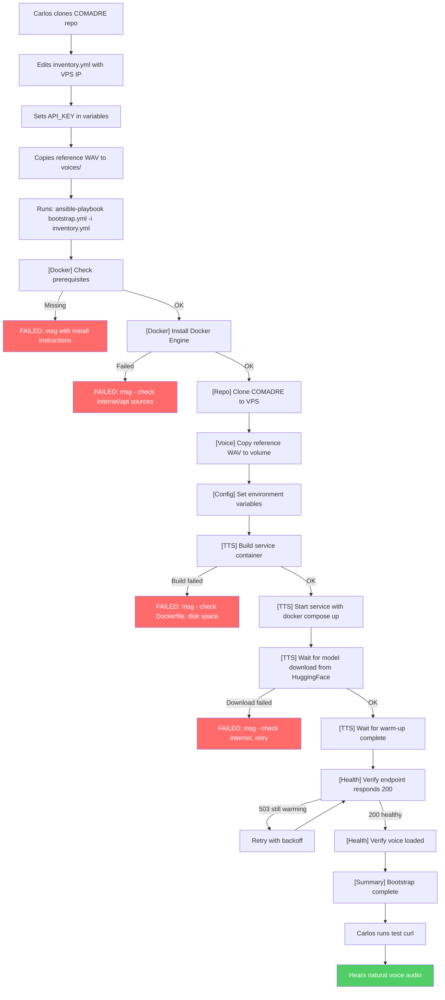
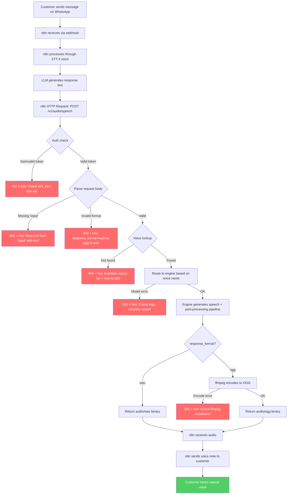
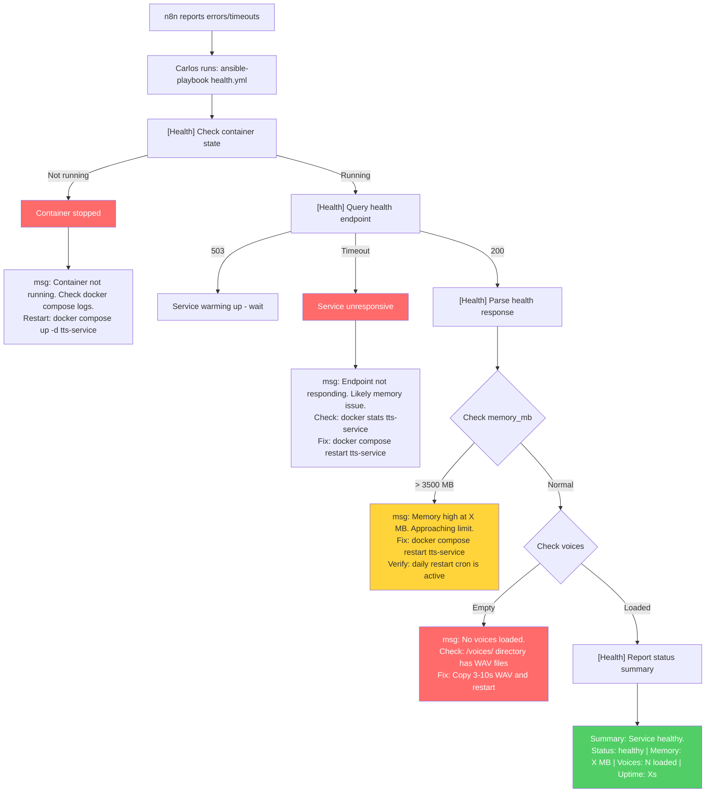

# UX Design Specification comadre

**Author:** Galvani
**Date:** 2026-03-21

---

<!-- UX design content will be appended sequentially through collaborative workflow steps -->

## Executive Summary

### Project Vision

COMADRE is a headless, self-hosted TTS service with optional dual-engine TTS via dual-engine architecture — a pure API backend with no graphical interface. The UX domain is API ergonomics, developer experience, and operational workflows. The "interfaces" are: the HTTP API contract (consumed by n8n), the health endpoint (consumed by monitoring and operators), Ansible playbook output (the operator's primary interaction surface), and error/log messages (the service's voice when things go wrong).

### Target Users

**n8n Workflow Engine (Machine Consumer)**
The primary consumer. Interacts exclusively via HTTP. UX needs: predictable OpenAI-compatible contract, clear error codes for programmatic handling, timely responses (Kokoro 5-16s, Qwen3 12-37s — acceptable for async WhatsApp), and a reliable warm-up/readiness signal (503 → 200 transition).

**DevOps Operator (Human — "Carlos")**
Deploys, updates, monitors, and decommissions via Ansible CLI and SSH. UX needs: single-command lifecycle operations, data preservation guarantees on updates, at-a-glance health status, guided first-run experience, and clear failure diagnostics.

**End Customers (Indirect Beneficiaries)**
Hear the natural voice on WhatsApp/Telegram. Never interact with COMADRE directly. UX impact: voice quality and latency determine their experience, but they are outside the design boundary.

### Key Design Challenges

1. **API Error Clarity** — Error responses must be self-explanatory and actionable for both machine parsing (n8n) and human debugging (operator). Every error code needs a clear message, and edge cases (warm-up in progress, voice not found, malformed input) must be distinguishable.

2. **Operational Transparency** — The operator has no dashboard — only the health endpoint, docker stats, and Ansible output. These surfaces must expose enough state (warm-up progress, memory usage, loaded voices, uptime) to replace a monitoring UI.

3. **First-Run Confidence** — Bootstrap involves multiple steps (inventory config, API key, voice provisioning, model download, warm-up). The operator must feel guided and confident that each step succeeded, with clear signals if something fails.

4. **Graceful Degradation Communication** — Memory leaks, model failures, and missing voice files must produce clear, specific signals — not generic 500 errors or silent hangs.

### Design Opportunities

1. **Rich Health Endpoint** — Transform the health response from a binary "ok/not ok" into an operational snapshot: status, loaded voices, memory usage, uptime, warm-up state. This becomes the operator's lightweight dashboard.

2. **Self-Documenting Error Responses** — Include actionable context in error bodies (available voices, expected format, configuration hints) so the operator can resolve issues without leaving the terminal.

3. **Ansible Output as UX Surface** — Treat playbook task names, status messages, and summary reports as a designed interface. Clear, consistent output makes operations feel reliable and professional.

## Core User Experience

### Defining Experience

COMADRE has two distinct interaction surfaces, each with its own "core experience":

**API Consumer (n8n):** The defining experience is `POST /v1/audio/speech` — text in, audio out. This request/response cycle executes on every customer interaction and must be indistinguishable from calling the OpenAI audio API. The core loop is: receive text from LLM → POST to COMADRE → receive audio binary → send to customer. Any friction in this loop (unexpected response format, unclear errors, inconsistent behavior) breaks the automation chain.

**DevOps Operator (Carlos):** The defining experience is the first deployment. Running `ansible-playbook bootstrap.yml` and hearing natural-voice audio from the first test `curl` is the moment COMADRE proves its value. Every subsequent interaction (update, health check, troubleshooting) must reinforce the confidence established in that first deployment.

### Platform Strategy

| Surface | Platform | Interface | Constraints |
|---|---|---|---|
| API Consumer | HTTP/REST over local network | OpenAI-compatible JSON → binary audio | Must work with n8n HTTP Request node without custom code |
| DevOps Operator | Terminal (Ansible CLI + SSH) | stdout/stderr, JSON health responses | Must work over SSH from any machine with Ansible installed |
| Health Monitoring | HTTP GET | JSON health response | Must be unauthenticated for monitoring tool integration |

No browser-based UI. No mobile considerations. No offline mode. The service is always-on server-side infrastructure accessed exclusively through HTTP and terminal interfaces.

### Effortless Interactions

1. **API integration should require zero learning** — If you've used OpenAI's `POST /v1/audio/speech`, you already know COMADRE's API. Same contract, same fields, same response behavior. Drop-in replacement.

2. **Deployment should feel like a single button press** — `ansible-playbook bootstrap.yml` handles everything: Docker install, repo clone, voice provisioning, container build, model download, warm-up. No mid-flight decisions, no manual steps between tasks.

3. **Error recovery should be self-guided** — Every error message includes what happened, why, and what to do next. The operator never needs to leave the terminal to consult documentation.

4. **Health checks should answer the question immediately** — "Is it working?" gets a yes/no with context (memory, uptime, voices loaded), not raw data requiring interpretation.

### Critical Success Moments

1. **First audio from first curl** — Bootstrap completes, operator runs a test request, hears the natural voice. This is the trust-establishing moment. If this works cleanly, the operator believes in the system.

2. **First production customer response** — n8n sends real customer text, audio arrives before the customer moves on, customer hears a natural voice on WhatsApp. The system delivers its core promise.

3. **First update preserves everything** — Operator runs `update.yml`, service restarts with new code, voices and cache intact. Trust is reinforced — updates are safe.

4. **First incident resolution** — Something breaks at 2 AM. Operator runs `health.yml`, gets an actionable diagnosis, resolves the issue without escalation. The system supports the operator under stress.

### Experience Principles

1. **Zero-Surprise API** — Follow the OpenAI audio API contract exactly. If a developer knows OpenAI's TTS endpoint, they know COMADRE. No deviations, no custom fields, no unexpected behaviors.

2. **One Command, One Outcome** — Every Ansible playbook does exactly one thing, reports its result clearly, and never requires follow-up manual steps. The operator's mental model is always: run one command, get one result.

3. **Errors Are Instructions** — Every error response and failure message tells the operator what happened, why, and what to do about it. No error codes without context. No failures without guidance.

4. **Transparency Over Silence** — The service always communicates its state: warming up (503), healthy (200), voice not found (404), overloaded. Never a black box. The operator can always ask "what's going on?" and get an honest, specific answer.

## Desired Emotional Response

### Primary Emotional Goals

**Confidence** — The dominant emotion across all interactions. Carlos trusts that bootstrap will complete, that updates won't break things, that health checks tell the truth, and that the service does exactly what the documentation says. The n8n developer trusts the API contract is OpenAI-identical. Confidence is earned through predictability and transparency.

**Relief** — The service eliminates an entire class of operational anxiety. No cloud dependency, no per-request billing, no data leaving the network, no third-party outage risk. Once deployed, COMADRE is one less thing to worry about.

**Ownership** — Carlos owns this service completely. It runs on his hardware, serves his network, clones his employee's voice. There's no vendor lock-in, no account dashboard, no subscription to manage. This feeling of total control is a core differentiator from cloud TTS.

### Emotional Journey Mapping

| Stage | Desired Emotion | Trigger |
|---|---|---|
| Discovery (reading docs) | Clarity — "I understand exactly what this does and doesn't do" | Concise, honest documentation with no marketing fluff |
| First bootstrap | Guided confidence — "Each step is working, I can see progress" | Clear Ansible task names, visible progress, no silent pauses |
| First test curl | Delight — "It actually sounds like a real person" | High-quality natural voice audio from the first request |
| Production integration | Relief — "It just plugs in, no custom code" | OpenAI-compatible API works with n8n HTTP Request node immediately |
| Routine operation | Forgettable — "I don't think about it, it just runs" | Service runs silently, daily restart cron handles memory leak |
| Incident at 2 AM | Calm control — "I know what's wrong and how to fix it" | Health playbook gives actionable diagnosis, not raw data |
| Update cycle | Reassurance — "Nothing broke, everything's still there" | Voices, cache, and config confirmed intact after update |
| Decommission | Clean closure — "It's gone, completely" | Zero artifacts remain, VPS is clean for reuse |

### Micro-Emotions

**Confidence vs. Confusion** — Most critical. Every interaction surface (API response, error message, Ansible output, health check) must reinforce confidence. A single confusing moment (unclear error, unexpected behavior, silent failure) erodes trust disproportionately.

**Trust vs. Skepticism** — Earned through consistency. The API behaves the same on request #1 and request #10,000. Updates don't change behavior unexpectedly. Health reports reflect actual state, not cached status.

**Calm vs. Anxiety** — Especially critical during incidents. The health endpoint and playbook must provide enough information to act, without overwhelming the operator with noise. The goal is: operator reads the output, knows what to do, does it, service recovers.

**Emotions to actively avoid:**
- **Dependency anxiety** — "What if the cloud API goes down?" (eliminated by self-hosting)
- **Cost anxiety** — "How much will this month's bill be?" (eliminated by zero marginal cost)
- **Privacy concern** — "Is customer data leaving our network?" (eliminated by network isolation)
- **Abandonment fear** — "What if this project stops being maintained?" (mitigated by simplicity — ~80 lines of wrapper code, operator can maintain it)

### Design Implications

| Emotional Goal | UX Design Approach |
|---|---|
| Confidence | Consistent API contract, deterministic behavior, honest health reporting |
| Relief | Zero-config after bootstrap, no ongoing maintenance tasks, automated memory leak mitigation |
| Ownership | All data local, no phone-home, no external dependencies post-deploy, full lifecycle control via Ansible |
| Guided confidence (bootstrap) | Sequential Ansible tasks with descriptive names, clear success/failure per task, summary at end |
| Calm control (incidents) | Health endpoint with structured JSON, actionable Ansible health playbook output, specific error messages |
| Clean closure (decommission) | Cleanup playbook that reports every artifact removed, confirms zero remaining footprint |

### Emotional Design Principles

1. **Predictability Builds Trust** — The service must behave identically every time. Same input, same output. Same playbook, same result. Surprises destroy confidence faster than features build it.

2. **Silence Means Healthy** — In routine operation, the best emotional state is "I forgot about it." The service should require zero attention when working correctly. Noise only on actionable state changes.

3. **Errors Should Calm, Not Alarm** — When something goes wrong, the error message should reduce anxiety, not increase it. Structure: what happened → why → what to do → how to verify it's fixed.

4. **Show, Don't Claim** — Don't tell the operator "deployment successful" — show them the health check passing, the voice file loaded, the test request returning audio. Evidence over assertions.

## UX Pattern Analysis & Inspiration

### Inspiring Products Analysis

**OpenAI Audio API**
The API contract COMADRE explicitly mirrors. What they do well: dead-simple endpoint design (one URL, one method, JSON in, binary out), consistent error format with structured JSON bodies, bearer token auth as the single auth mechanism, and response format negotiation via a request field rather than content negotiation headers. The developer experience is "read one page of docs, make your first request in 60 seconds." What they don't do well for COMADRE's context: their errors assume cloud-scale concerns (rate limits, billing) that don't apply to a self-hosted single-consumer service.

**Caddy**
The gold standard for self-hosted infrastructure that "just works." What they do well: sensible defaults that eliminate configuration for common cases (automatic HTTPS, zero-config reverse proxy), a single static binary with no dependencies, clear and structured logging, and a config format (Caddyfile) that reads like plain English. The emotional signature is "I deployed it, it worked, I moved on." The key lesson for COMADRE: complexity should be opt-in, not mandatory. The default path should require the minimum viable configuration. Caddy's health and status reporting is also exemplary — clear, structured, and machine-parseable.

**Ansible + Docker Compose (Operational Baseline)**
The tools Carlos already uses daily. Ansible's strength: task-based output where each step has a descriptive name and a clear ok/changed/failed status. The operator watches sequential progress and knows exactly where a failure occurred. Docker Compose's strength: `docker compose up` as the canonical "one command to start everything" pattern, `docker compose ps` for instant status, and declarative service definitions that are self-documenting. Together, they set the operator's expectations for how infrastructure tooling should communicate.

### Transferable UX Patterns

**API Contract Patterns (from OpenAI):**
- Single endpoint, single method — no REST resource hierarchy to learn
- Request body fields match mental model: `input` (what to say), `voice` (who says it), `response_format` (how to encode it)
- Bearer token as the only auth mechanism — no OAuth flows, no API key headers, no session tokens
- Structured JSON error responses with `error.message` and `error.type` fields for both machine parsing and human reading

**Operational Patterns (from Caddy):**
- Sensible defaults eliminate config: if you don't specify a voice, use `DEFAULT_VOICE`; if you don't specify format, default to `ogg`
- Single artifact deployment: one Dockerfile, one docker-compose.yml, one Ansible playbook per operation
- Structured JSON health output that tools can parse and humans can read
- Clear startup logging: what's loading, what's ready, what failed — no silent boot

**Progress Communication Patterns (from Ansible):**
- Named tasks with clear status: `[ok]`, `[changed]`, `[failed]` — the operator never wonders "what's happening"
- Sequential output that maps to mental model: install Docker → clone repo → build container → start service → verify health
- Play recap at the end: summary of what succeeded, what changed, what failed — a single glance tells the full story
- Idempotency: running the same playbook twice doesn't break anything — the operator is safe to retry

### Anti-Patterns to Avoid

1. **Silent failures** — Services that return 200 OK but produce garbage output, or containers that start but never become healthy without explanation. COMADRE must fail loudly with specific reasons.

2. **Configuration sprawl** — Tools that require editing 5 files across 3 directories before anything works. COMADRE's configuration is environment variables in one docker-compose.yml and one Ansible inventory file. Two files, total.

3. **Undifferentiated error messages** — APIs that return "Internal Server Error" for everything from missing models to encoding failures. Every COMADRE error must be specific and actionable.

4. **Implicit dependencies** — Services that silently assume tools are installed or ports are available. Bootstrap must check prerequisites and report missing dependencies before attempting installation.

5. **Documentation-dependent operation** — Tools where you must read a wiki page to perform basic operations. COMADRE's Ansible playbooks should be self-explanatory: `bootstrap.yml`, `update.yml`, `cleanup.yml`, `health.yml` — the filename is the documentation.

### Design Inspiration Strategy

**Adopt directly:**
- OpenAI's exact API contract for `/v1/audio/speech` — zero deviation ensures zero learning curve
- Ansible's task-name-plus-status output pattern for all playbooks
- Caddy's "sensible defaults, complexity is opt-in" philosophy for all configuration

**Adapt for COMADRE's context:**
- OpenAI's error format — adopt the structure (`error.message`, `error.type`) but add a `hint` field with actionable recovery guidance, since COMADRE's operator can actually fix things (unlike a cloud API consumer)
- Caddy's health reporting — adapt to include COMADRE-specific state: loaded voices, memory usage, warm-up status, uptime
- Docker Compose's single-command pattern — extend via Ansible to cover the full lifecycle, not just start/stop

**Avoid deliberately:**
- OpenAI's rate-limit and billing error patterns — irrelevant for a single-consumer self-hosted service
- Complex configuration file formats — no YAML anchors, no template inheritance, no config-of-config
- Multi-step manual processes — if it takes more than one command, it should be automated into a playbook

## Design System Foundation

### Design System Choice

**API & Operational Design System** — COMADRE has no UI, so the traditional design system concept (component libraries, visual tokens, typography scales) does not apply. Instead, COMADRE adopts a contract consistency system: a set of standards ensuring every interaction surface — API responses, error formats, health schema, Ansible output, and log messages — follows predictable, documented patterns.

This is the "design system" for a headless service: not visual components, but interaction contracts that serve the same purpose — consistency, predictability, and reduced cognitive load for consumers.

### Rationale for Selection

- **No frontend exists** — COMADRE has zero visual UI. No browser, no mobile app, no admin panel. Choosing a visual design system (Material, Chakra, Tailwind) would be solving a problem that doesn't exist.
- **Interaction surfaces are non-visual** — The "interfaces" are HTTP responses, JSON schemas, terminal output, and log streams. These need their own consistency standards.
- **Two consumers with different parsing needs** — n8n parses JSON programmatically; the DevOps operator reads terminal output visually. The design system must serve both.
- **OpenAI compatibility constrains the API surface** — The primary API contract is already defined by the OpenAI audio API spec. The design system extends this with consistent error handling and health reporting.

### Implementation Approach

**Four interaction contract layers:**

**1. API Response Contract (OpenAI-compatible)**
- Success: binary audio with appropriate `Content-Type` (`audio/wav`, `audio/ogg`)
- Error: structured JSON following OpenAI's error format, extended with a `hint` field

```json
{
  "error": {
    "message": "Voice 'maria' not found",
    "type": "invalid_request_error",
    "hint": "Available voices: ['carlos']. Place WAV files (3-10s) in the /voices/ directory."
  }
}
```

- HTTP status codes: 200 (success), 400 (bad request), 401 (unauthorized), 404 (voice not found), 500 (internal error), 503 (warming up)

**2. Health Response Schema**

```json
{
  "status": "healthy|warming_up|degraded",
  "voices": ["santa", "dora", "alex", "clone", "qwen-female", "qwen-male"],
  "engines": {"kokoro": {"loaded": true, "voices": ["santa", "dora", "alex"]}, "qwen3": {"loaded": true, "model": "q8_0", "clone_reference": "configured"}},
  "queue_depth": 0,
  "clone_configured": true,
  "uptime_seconds": 3600,
  "memory_mb": 4200,
  "version": "0.2.0"
}
```

- Always JSON, always the same fields, always machine-parseable
- `status` uses an enum, not free text — monitoring tools can match on exact values

**3. Ansible Output Conventions**
- Task names follow the pattern: `[Component] Action description` (e.g., `[Docker] Install Docker Engine`, `[TTS] Build service container`, `[Health] Verify endpoint responds`)
- Every playbook ends with a summary task that reports final state
- Failure tasks include a `msg` with actionable guidance, not just the error

**4. Log Message Format**
- Structured logging: `timestamp | level | component | message`
- Levels: `INFO` (normal operation), `WARNING` (degraded but functional), `ERROR` (request failed), `CRITICAL` (service cannot continue)
- Startup sequence logs each phase: model loading, voice discovery, warm-up, ready

### Customization Strategy

The design system is minimal by design — customization is limited to:

- **Error hints** — can be extended with new hint messages as new error scenarios are discovered
- **Health fields** — new fields can be added to the health response without breaking existing consumers (additive only)
- **Log context** — additional structured fields can be added to log entries for debugging without changing the base format
- **Ansible task naming** — new playbooks follow the established `[Component] Action` pattern

No visual theming, no brand tokens, no typography decisions. The "brand" is consistency and clarity in every machine and human interaction.

## Defining Core Experience

### Defining Experience

COMADRE's defining experience is making something complex feel like something users already do every day:

**For n8n (machine consumer):** "Send text, get back a human-sounding voice — in one HTTP call." The defining moment is indistinguishable from calling OpenAI's API, except the response comes from local hardware with a natural voice. The innovation is invisible — it's in the result, not the interaction.

**For Carlos (DevOps operator):** "Run one command, get a working dual-engine TTS service." The defining moment is hearing natural-voice audio from the first test curl after bootstrap. A complex ML pipeline (TTS + voice conversion + audio encoding) reduced to a familiar Ansible workflow.

The product's genius is that users never feel like they're doing something new. They feel like they're doing something they already know — but the output is remarkable.

### User Mental Model

**n8n Developer Mental Model:**
"It's just like calling OpenAI, but it's local." This mental model must never be violated. The developer expects:
- Same endpoint path (`/v1/audio/speech`)
- Same request fields (`input`, `voice`, `response_format`)
- Same auth mechanism (bearer token)
- Same response behavior (binary audio stream)
- Same error structure (JSON with `error.message`)

Any deviation — a custom header, an extra required field, a different error format — breaks the mental model and creates friction disproportionate to the change.

**DevOps Operator Mental Model:**
"It's just another Docker service I deploy with Ansible." Carlos expects:
- One playbook per operation (bootstrap, update, cleanup, health)
- Docker Compose for service orchestration
- Environment variables for configuration
- Volume mounts for persistent data
- Health endpoint for monitoring
- Logs via `docker compose logs`

COMADRE must fit into Carlos's existing operational workflow, not create a new one.

### Success Criteria

**Audio Generation Loop (n8n):**

| Criteria | Measurement |
|---|---|
| API contract matches OpenAI exactly | n8n HTTP Request node works with zero custom configuration |
| Response contains valid audio | Output plays correctly on WhatsApp/Telegram |
| Latency is imperceptible to workflow | Kokoro typical 5-16s, Qwen3 typical 12-37s — acceptable for async WhatsApp conversations |
| Errors are parseable by n8n | n8n IF node can route on HTTP status code and error type |
| Voice sounds natural and consistent | Manual listening test: natural voice is recognizable across requests |

**Service Lifecycle Loop (Carlos):**

| Criteria | Measurement |
|---|---|
| Bootstrap works first time | Single `ansible-playbook bootstrap.yml` on clean VPS reaches healthy state |
| Operator always knows what's happening | Every Ansible task has a descriptive name and clear status |
| Failures are immediately diagnosable | Error messages include what failed, why, and what to do |
| Updates are safe | Voices, model cache, and API key survive `update.yml` 100% of the time |
| Health check answers the question | `health.yml` output tells Carlos whether to act and what to do |

### Novel UX Patterns

COMADRE uses **zero novel interaction patterns**. Both core loops follow established conventions:

- **API loop:** Standard REST request/response, identical to OpenAI's audio API — a pattern millions of developers already know
- **Ops loop:** Standard Ansible playbook execution with Docker Compose — a pattern every DevOps engineer uses daily

**The innovation is in the output, not the interaction.** Dual-engine TTS with perfect sigla pronunciation and optional voice cloning on commodity hardware is remarkable. The way you access it is deliberately unremarkable. This is a conscious design choice: reducing cognitive load to zero by meeting users exactly where they already are.

**One adapted pattern:** The `error.hint` field in API error responses. This extends the OpenAI error format (established) with actionable recovery guidance (adapted). It's a minor addition that doesn't break the existing mental model but adds significant value for a self-hosted context where the operator can actually fix things.

### Experience Mechanics

**Loop 1: Audio Generation (n8n → COMADRE → Customer)**

```
1. INITIATION
   n8n workflow receives customer message
   → LLM generates response text
   → Workflow triggers HTTP Request node

2. INTERACTION
   POST /v1/audio/speech
   Headers: Authorization: Bearer <API_KEY>
   Body: { "input": "text", "voice": "carlos", "response_format": "ogg" }

3. FEEDBACK
   Success (200): Binary audio stream returned
   → Content-Type: audio/ogg
   → Audio duration proportional to text length

   Failure: Structured JSON error
   → 401: Invalid/missing API key + hint
   → 400: Malformed request + hint with expected format
   → 404: Voice not found + hint listing available voices
   → 503: Service warming up + hint to retry in N seconds
   → 500: Internal error + hint with log location

4. COMPLETION
   n8n receives audio binary
   → Forwards to WhatsApp/Telegram as voice note
   → Customer hears natural voice response
```

**Loop 2: Service Lifecycle (Carlos → Ansible → COMADRE)**

```
1. INITIATION
   Carlos identifies operation needed
   → Selects playbook: bootstrap.yml | update.yml | cleanup.yml | health.yml

2. INTERACTION
   $ ansible-playbook <playbook>.yml -i inventory.yml
   → Sequential tasks execute with named output
   → Each task: [Component] Action description ... ok/changed/failed

3. FEEDBACK
   Per-task: Clear status with component context
   → [Docker] Install Docker Engine ............... ok
   → [TTS] Build service container ................ changed
   → [Health] Verify endpoint responds ............ ok

   On failure: Actionable error message
   → TASK [Docker] Install Docker Engine ... FAILED
   → msg: "Docker installation failed. Check internet connectivity
            and ensure apt sources are accessible."

4. COMPLETION
   Play recap: summary of all tasks
   → ok=12  changed=3  failed=0
   Final task: health verification or state confirmation
   → "COMADRE is healthy. Voice 'carlos' loaded. Uptime: 45s."
```

## Visual Design Foundation

### Information Formatting Foundation

COMADRE has no visual UI — no screens, no components, no color palette. The "visual foundation" is an information formatting system that ensures every human-readable output (documentation, JSON responses, terminal output, logs) is consistent, scannable, and immediately useful.

### JSON Schema Conventions

All JSON output follows consistent formatting rules:

**Field Naming:** `snake_case` everywhere — `response_format`, `uptime_seconds`, `memory_mb`. No camelCase, no kebab-case, no mixed conventions.

**Nesting Depth:** Maximum two levels. Error responses nest under `error.{field}`. Health responses are flat. No deeply nested structures that require mental parsing.

**Consistent Field Order:** Status/type fields first, data fields next, metadata last. The most important information appears at the top of every response.

**Error Response Format:**
```json
{
  "error": {
    "message": "Human-readable description of what went wrong",
    "type": "error_category",
    "hint": "Actionable recovery step the operator can take"
  }
}
```

**Health Response Format:**
```json
{
  "status": "healthy",
  "voices": ["santa", "dora", "alex", "clone", "qwen-female", "qwen-male"],
  "engines": {"kokoro": {"loaded": true, "voices": ["santa", "dora", "alex"]}, "qwen3": {"loaded": true, "model": "q8_0", "clone_reference": "configured"}},
  "queue_depth": 0,
  "clone_configured": true,
  "uptime_seconds": 3600,
  "memory_mb": 4200,
  "version": "0.2.0"
}
```

### Terminal Output Readability

**Ansible Task Naming:**
- Pattern: `[Component] Action description`
- Examples: `[Docker] Install Docker Engine`, `[TTS] Build service container`, `[Health] Verify endpoint responds`
- Components are consistent across playbooks: `[Docker]`, `[TTS]`, `[Voice]`, `[Health]`, `[Config]`, `[Cleanup]`

**Ansible Summary Tasks:**
Every playbook ends with a debug task that summarizes the outcome in human-readable format:
```
TASK [Summary] *********
ok: [vps] => {
  "msg": "COMADRE bootstrap complete. Service healthy. Voice 'carlos' loaded. Endpoint: http://vps:8000/v1/audio/speech"
}
```

**Application Log Format:**
```
2026-03-21T14:32:00Z | INFO  | startup  | Loading Kokoro TTS model...
2026-03-21T14:32:15Z | INFO  | startup  | Model loaded. Loading voice files...
2026-03-21T14:32:16Z | INFO  | startup  | Voice 'carlos' loaded from /voices/carlos.wav
2026-03-21T14:32:16Z | INFO  | startup  | Warm-up complete. Service ready.
2026-03-21T14:32:20Z | INFO  | request  | POST /v1/audio/speech | voice=carlos | format=ogg | chars=45 | duration=1.8s
2026-03-21T14:35:00Z | WARN  | memory   | RAM usage at 3.2 GB (threshold: 3.5 GB)
2026-03-21T14:40:00Z | ERROR | request  | POST /v1/audio/speech | voice=maria | 404 Voice not found
```

- Pipe-delimited for easy grep and awk processing
- Timestamp in ISO 8601 UTC
- Fixed-width level field (INFO/WARN/ERROR/CRIT) for visual alignment
- Component field for filtering: `startup`, `request`, `memory`, `health`

### Documentation Standards

**README.md (Brazilian Portuguese — public-facing):**
- Starts with project name and one-line description
- Quick start section within the first screen (no scrolling to see how to begin)
- Copy-paste-ready commands with realistic example values
- Badge section: build status, license, Python version

**English Documentation (operator-facing):**
- One document per concern: API reference, deployment guide, configuration reference, troubleshooting
- Every code block is copy-paste-ready — no placeholder values that require editing without clear indication
- Headings are scannable: operator finds what they need by scrolling, not by reading
- Configuration tables: variable name, default value, description, example — four columns, always

**Code Example Formatting:**
```bash
# Always show the full command with realistic values
curl -X POST http://localhost:8000/v1/audio/speech \
  -H "Authorization: Bearer your-api-key-here" \
  -H "Content-Type: application/json" \
  -d '{"input": "Olá, como posso ajudar?", "voice": "carlos", "response_format": "ogg"}' \
  --output response.ogg
```

- Comments explain what the command does, not what each flag means
- Output shown when it's not obvious what to expect
- Error examples included alongside success examples

### Accessibility Considerations

Traditional visual accessibility (contrast ratios, screen readers, WCAG) does not apply — there is no visual UI. Accessibility for COMADRE means:

- **Terminal accessibility:** Log and Ansible output uses plain ASCII — no emoji, no Unicode box-drawing characters, no color codes that break in non-ANSI terminals
- **JSON readability:** Responses are pretty-printable with `jq` and parseable by any JSON library
- **Documentation accessibility:** Markdown renders correctly in any viewer (GitHub, terminal `cat`, VS Code, plain text)
- **Error message clarity:** Messages use plain English, avoid jargon, and assume the reader may not be a native English speaker

## Design Direction Decision

### Design Directions Explored

Three interaction design directions were evaluated for COMADRE's non-visual interface surfaces:

**Direction 1: Minimal — "Invisible Infrastructure"**
Strict OpenAI clone with zero additions. Standard Ansible output, standard Python logging. Minimal surface area, minimal opinion. Rejected because it sacrifices operator experience for purity — in a self-hosted context, the operator needs more guidance than a cloud API consumer.

**Direction 2: Opinionated — "Operator-First DX"**
OpenAI-compatible base extended with actionable error hints, rich health endpoint, structured Ansible output with component naming and summary tasks, and pipe-delimited structured logging. Every interaction surface designed to reduce cognitive load. Selected as the right balance of helpfulness and simplicity.

**Direction 3: Verbose — "Full Observability"**
Maximum visibility with Prometheus metrics, JSON structured logging for aggregation, request metrics in health endpoint, and HTML report generation from Ansible. Rejected as over-engineering for a single-consumer, solo-developer service — the observability investment doesn't match the operational complexity.

### Chosen Direction

**Direction 2: Opinionated — "Operator-First DX"**

The service extends established patterns (OpenAI API, Ansible conventions) with targeted additions that make the operator's life easier, without introducing complexity that requires its own maintenance burden.

**Key elements of the chosen direction:**

| Surface | Base Pattern | COMADRE Extension |
|---|---|---|
| API success responses | OpenAI-identical binary audio | None — exact match |
| API error responses | OpenAI JSON error format | Added `hint` field with actionable recovery guidance |
| Health endpoint | Simple status JSON | Extended with voices, engines, queue_depth, clone_configured, memory, uptime, version, warm-up status |
| Ansible playbooks | Standard task execution | `[Component] Action` naming, summary tasks, prerequisite checks |
| Application logs | Python logging | Pipe-delimited structured format with component tags |
| Documentation | Standard markdown | Copy-paste-ready examples, configuration tables, error examples alongside successes |

### Design Rationale

1. **Matches project scale** — COMADRE is a single-purpose service with one consumer and one operator. Direction 2 adds exactly enough intelligence to the interaction surfaces without creating new maintenance burden. No Prometheus, no log aggregation, no dashboards to maintain.

2. **Supports the experience principles** — "Errors Are Instructions" requires the `hint` field. "Transparency Over Silence" requires the rich health endpoint. "One Command, One Outcome" requires structured Ansible output with summaries. Direction 2 is the minimum implementation of these principles.

3. **Respects operator context** — The operator is working via SSH and terminal. Pipe-delimited logs are grep-friendly. Ansible task names are scannable. Health JSON is `curl | jq`-friendly. Every extension is designed for the terminal, not for a dashboard.

4. **Keeps the API contract clean** — Success responses are pure OpenAI-compatible binary audio. The `hint` field only appears in error responses, and it's additive — any client that ignores it gets standard OpenAI error behavior. No breaking changes to the established pattern.

### Implementation Approach

**Phase 1 (MVP):** Implement all Direction 2 elements as part of the initial build:
- Error responses with `hint` field in FastAPI exception handlers
- Rich health endpoint with all fields in the health route
- Structured logging configured at application startup
- Ansible playbooks with naming conventions and summary tasks

**No phased rollout needed** — Direction 2 is simple enough to implement fully in the MVP. The extensions are small additions to code that must exist anyway (error handlers, health endpoint, logging config, Ansible tasks).

## User Journey Flows

### Journey 1: First Deployment (Bootstrap)

The most critical journey — where trust is established or lost.

**Entry point:** Carlos has a clean Ubuntu VPS, cloned the COMADRE repo, and has a reference WAV file.

**Pre-requisites:** VPS IP, SSH access, API key chosen, reference WAV file ready.



**Key UX decisions:**
- Every Ansible task has a `[Component]` prefix so Carlos can identify which subsystem failed
- Failure messages include specific recovery actions, not just error descriptions
- Model download is a visible, named task — not a silent hang during container startup
- Bootstrap ends with health verification, not just "container started" — Carlos sees proof it works
- The test curl is documented in the summary task output so Carlos knows exactly what to run next

### Journey 2: Routine Operation (Audio Generation)

The high-frequency loop — must be invisible and fast.

**Entry point:** n8n workflow receives a customer message and needs to generate audio.



**Key UX decisions:**
- Every error branch returns a specific HTTP status code + `hint` field — n8n can route on status code, operator can read the hint
- Voice not found includes the list of available voices — eliminates a round-trip to the health endpoint
- 503 during warm-up is handled separately (not shown in this flow but documented in the health check flow) so n8n can implement retry logic
- Success path is linear with zero decision points for the consumer — complexity is all in error handling

### Journey 3: Troubleshooting (Incident Response)

The highest-stress journey — must reduce anxiety, not increase it.

**Entry point:** n8n starts getting timeouts or errors from COMADRE. Carlos investigates.



**Key UX decisions:**
- Health playbook follows a diagnostic tree — each check narrows the problem
- Every failure state includes three elements: what's wrong, how to verify, how to fix
- Memory warning (yellow) is distinct from failure (red) — not everything is a crisis
- The summary at the end always shows the same fields in the same order — Carlos builds muscle memory for reading it
- Container-not-running and endpoint-unresponsive are separate diagnoses with separate fixes

### Journey Patterns

Across all journeys, three reusable patterns emerge:

**Pattern 1: Diagnostic Cascade**
Check the broadest condition first, narrow progressively. Container running → endpoint responding → health data normal → specific metrics. Each level has its own failure message and recovery action.

**Pattern 2: Error Response Trinity**
Every error, whether API response or Ansible failure, follows the same three-part structure:
1. **What** — clear description of the problem
2. **Why** — context about the likely cause
3. **Do** — specific action to resolve

**Pattern 3: Confirmation Closure**
Every journey ends with positive confirmation of the final state, not just absence of errors:
- Bootstrap: "Service healthy. Voice loaded. Endpoint: ..."
- Audio generation: HTTP 200 + valid audio binary
- Health check: Full status summary with all metrics
- Update: "Service healthy. Data preserved. Voice: ..."
- Cleanup: "Zero COMADRE artifacts remain."

### Flow Optimization Principles

1. **Fail fast, fail specific** — Check preconditions before expensive operations. Don't download models if Docker isn't installed. Don't generate audio if the voice file is missing.

2. **Linear success, branching failure** — The happy path through any journey is a straight line. Complexity exists only in error handling. Users moving forward should never encounter decision points.

3. **Every dead end has a door** — No error state is terminal without guidance. Every failure branch includes an actionable recovery step that leads back to the success path.

4. **Progressive diagnosis, not information dump** — Health checks report the most likely problem first, not everything at once. If the container isn't running, don't also report that the endpoint is unreachable — that's obvious.

## Component Strategy

### Design System Components

COMADRE's "design system" has no visual components. The foundation components are established patterns from the technology stack that require no custom design:

| Foundation Component | Source | Purpose |
|---|---|---|
| HTTP request/response cycle | FastAPI standard | Core API interaction |
| Bearer token auth middleware | FastAPI dependency injection | Request authentication |
| Pydantic request/response models | FastAPI/Pydantic standard | Request validation and serialization |
| Docker Compose service definition | Docker standard | Container orchestration |
| Ansible playbook/role structure | Ansible standard | Operational lifecycle |
| Python logging module | Python standard library | Base logging infrastructure |

These are off-the-shelf patterns. No customization needed beyond configuration.

### Custom Components

Five custom components bridge the gap between standard tooling and COMADRE's "Operator-First DX" design direction:

#### 1. Error Response Builder

**Purpose:** Produces consistent OpenAI-compatible error responses with actionable recovery hints across all API error paths.

**Specification:**
- Input: HTTP status code, error message, error type, recovery hint
- Output: JSON response matching OpenAI error format + `hint` field
- States: 400 (bad request), 401 (unauthorized), 404 (not found), 500 (internal error), 503 (warming up)

**Implementation:** FastAPI exception handler registered at application startup. All error paths raise typed exceptions; the handler formats them uniformly.

```python
# Usage pattern
raise VoiceNotFoundError(
    voice="maria",
    available=["carlos"],
    hint="Place WAV files (3-10s) in the /voices/ directory."
)
# Produces: 404 {"error": {"message": "Voice 'maria' not found", "type": "invalid_request_error", "hint": "..."}}
```

**Design rationale:** Centralizing error formatting guarantees every error path follows the Error Response Trinity (What/Why/Do) without relying on each endpoint to format its own errors.

#### 2. Health Response Assembler

**Purpose:** Collects runtime metrics from multiple sources into the standardized health JSON response.

**Specification:**
- Input: None (reads from runtime state)
- Output: JSON with `status`, `voices`, `engines`, `queue_depth`, `clone_configured`, `uptime_seconds`, `memory_mb`, `version`
- States: `healthy` (all systems normal), `warming_up` (models loading), `degraded` (high memory or missing voices)
- Sources: `psutil` for memory, voice config for voices/engines, startup timestamp for uptime, asyncio.Lock state for queue_depth, clone reference path for clone_configured

**Implementation:** Called by the `GET /health` endpoint. Aggregates data from multiple sources into a single flat JSON response.

```json
{
  "status": "healthy",
  "voices": ["santa", "dora", "alex", "clone", "qwen-female", "qwen-male"],
  "engines": {"kokoro": {"loaded": true, "voices": ["santa", "dora", "alex"]}, "qwen3": {"loaded": true, "model": "q8_0", "clone_reference": "configured"}},
  "queue_depth": 0,
  "clone_configured": true,
  "uptime_seconds": 3600,
  "memory_mb": 4200,
  "version": "0.2.0"
}
```

**Design rationale:** The health endpoint is the operator's "dashboard." Centralizing the assembly ensures consistent field order, naming, and status logic regardless of which code path updates runtime state.

#### 3. Structured Logger

**Purpose:** Configures application-wide logging in the pipe-delimited format with component tags for grep-friendly terminal output.

**Specification:**
- Format: `timestamp | level | component | message`
- Levels: `INFO`, `WARN`, `ERROR`, `CRIT` (fixed-width for visual alignment)
- Components: `startup`, `request`, `memory`, `health`, `voice`
- Timestamp: ISO 8601 UTC

**Implementation:** Custom Python logging formatter configured at application startup. All application code uses standard `logging.getLogger(component)` calls.

```
2026-03-21T14:32:00Z | INFO  | startup  | Loading Kokoro TTS model...
2026-03-21T14:32:20Z | INFO  | request  | POST /v1/audio/speech | voice=carlos | format=ogg | chars=45 | duration=1.8s
```

**Design rationale:** Pipe-delimited format is both human-scannable and machine-parseable (`grep`, `awk`, `cut`). Fixed-width level field creates visual columns in terminal output without requiring a log aggregation tool.

#### 4. Ansible Summary Task

**Purpose:** Reusable Ansible task template that produces standardized summary output at the end of every playbook.

**Specification:**
- Input: Playbook-specific variables (service status, voices loaded, endpoint URL, etc.)
- Output: `debug` task with formatted `msg` summarizing the operation outcome
- Variants: bootstrap summary, update summary, health summary, cleanup summary

**Implementation:** Ansible `debug` task as the final task in every playbook, using registered variables from preceding tasks.

```yaml
- name: "[Summary] Bootstrap complete"
  debug:
    msg: >-
      COMADRE bootstrap complete.
      Service: {{ health_status }}.
      Voice: '{{ voice_name }}' loaded.
      Endpoint: http://{{ ansible_host }}:8000/v1/audio/speech
      Test: curl -X POST http://{{ ansible_host }}:8000/v1/audio/speech
      -H 'Authorization: Bearer {{ api_key }}'
      -H 'Content-Type: application/json'
      -d '{"input": "Teste de audio", "voice": "{{ voice_name }}", "response_format": "wav"}'
      --output test.wav
```

**Design rationale:** Every playbook ends with a Confirmation Closure — positive proof of the final state. Including the test curl command in the bootstrap summary eliminates the "what do I do next?" moment.

#### 5. Voice Discovery Module

**Purpose:** Scans the voices directory, validates WAV files, and reports loaded voices at startup and via health endpoint.

**Specification:**
- Input: Voices directory path (from `DEFAULT_VOICE` env var or `/voices/` default)
- Output: List of valid voice names, validation warnings for invalid files
- Validation: File exists, is a valid WAV, is 3-10 seconds duration
- States: voices found and loaded, directory empty, directory missing, invalid files detected

**Implementation:** Called at startup (to log loaded voices and warn about issues) and by the health assembler (to report current voice state).

```
2026-03-21T14:32:16Z | INFO  | voice    | Voice 'carlos' loaded from /voices/carlos.wav (5.2s)
2026-03-21T14:32:16Z | WARN  | voice    | File /voices/test.mp3 skipped: not a WAV file
2026-03-21T14:32:16Z | WARN  | voice    | File /voices/long.wav skipped: duration 45.0s exceeds 10s limit
```

**Design rationale:** Voice file issues are a common source of confusion ("why doesn't my voice work?"). Validating and reporting at startup catches problems before the first request, not during.

### Component Implementation Strategy

All five custom components are implemented in the MVP — none are deferred:

| Component | Implementation Size | Dependency |
|---|---|---|
| Error Response Builder | ~30 lines (exception classes + handler) | FastAPI exception handling |
| Health Response Assembler | ~20 lines (metric collection + JSON) | psutil for memory |
| Structured Logger | ~15 lines (custom formatter + config) | Python logging stdlib |
| Ansible Summary Task | ~10 lines per playbook (debug task) | Ansible registered variables |
| Voice Discovery Module | ~40 lines (scan + validate + report) | Python wave stdlib |

**Total custom code:** ~150 lines across all five components. This is consistent with COMADRE's ~80 line FastAPI wrapper philosophy — the interaction design components are small, focused, and self-contained.

### Implementation Roadmap

No phased roadmap needed — all components are small enough to build as part of the initial implementation:

**Build order (dependency-driven):**
1. **Structured Logger** — first, because all other components log through it
2. **Voice Discovery Module** — second, because health assembler depends on it
3. **Error Response Builder** — third, because API endpoints use it
4. **Health Response Assembler** — fourth, uses voice discovery and logger
5. **Ansible Summary Task** — last, because it references runtime outputs from the service

## UX Consistency Patterns

### Request/Response Pattern

**When:** Every API interaction (audio generation).

**Pattern:** OpenAI-compatible contract with consistent behavior:
- Request: JSON body with `input`, `voice`, `response_format` + bearer token header
- Success: Binary audio with correct `Content-Type` header, no JSON wrapper
- Failure: Structured JSON error with `message`, `type`, `hint`

**Consistency rules:**
- Field names are always `snake_case`
- Binary responses never include JSON metadata — the HTTP headers carry all metadata
- Error responses always include all three fields (`message`, `type`, `hint`) — never partial
- The `hint` field always contains an actionable instruction, never a restatement of the error

### Error Communication Pattern

**When:** Any error condition across any surface (API, Ansible, logs).

**Pattern:** Error Response Trinity — every error communicates three things:

| Element | API Response | Ansible Failure | Log Entry |
|---|---|---|---|
| **What** | `error.message` | Task name + `FAILED` | `ERROR \| component \| description` |
| **Why** | `error.type` | Implied by task context | Log message context |
| **Do** | `error.hint` | `msg` field with instructions | Actionable guidance in message |

**Consistency rules:**
- Never return an error code without a human-readable message
- Never describe a problem without suggesting a resolution
- Error types use a fixed vocabulary: `invalid_request_error`, `authentication_error`, `not_found_error`, `server_error`, `service_unavailable`
- Hints reference concrete actions: file paths, commands, config variables — not abstract advice

### Health Reporting Pattern

**When:** Service state inquiry (health endpoint, Ansible health playbook, startup logs).

**Pattern:** Consistent state vocabulary with the same fields in the same order:

| Field | Always Present | Purpose |
|---|---|---|
| `status` | Yes | Enum: `healthy`, `warming_up`, `degraded` |
| `voices` | Yes | Array of loaded voice names |
| `uptime_seconds` | Yes | Seconds since service start |
| `memory_mb` | Yes | Current RSS memory in MB |
| `engines` | Yes | Per-engine status and voice assignments |
| `queue_depth` | Yes | Current FIFO queue length |
| `clone_configured` | Yes | Whether clone reference WAV is available |
| `version` | Yes | Service version string |

**Consistency rules:**
- Status is always an enum, never free text — monitoring tools match on exact values
- All numeric fields use consistent units (seconds, not minutes; MB, not bytes)
- Field order never changes — humans build muscle memory for reading it
- Empty voices array is `[]`, never `null` or omitted — absence is explicit

### Operational Feedback Pattern

**When:** Ansible playbook execution (bootstrap, update, cleanup, health).

**Pattern:** Progressive task output with confirmation closure:

```
Phase 1: [Component] Prerequisite checks
Phase 2: [Component] Core operations
Phase 3: [Component] Verification
Phase 4: [Summary] Confirmation with proof
```

**Consistency rules:**
- Task names always start with `[Component]` in brackets
- Component names are consistent across all playbooks: `[Docker]`, `[TTS]`, `[Voice]`, `[Config]`, `[Health]`, `[Cleanup]`, `[Summary]`
- Every playbook ends with a `[Summary]` task — no playbook ends silently
- Summary messages include proof of final state, not just assertions of success
- Failed tasks include a `msg` with recovery instructions following the Error Response Trinity

### Startup Communication Pattern

**When:** Service container starts up.

**Pattern:** Sequential phase logging — each startup phase is logged as it begins and completes:

```
1. Model loading   → INFO | startup | Loading Kokoro TTS model...
2. Voice discovery  → INFO | voice   | Voice 'carlos' loaded (5.2s)
3. Warm-up         → INFO | startup | Running warm-up inference...
4. Ready           → INFO | startup | Service ready. Listening on 0.0.0.0:8000
```

**Consistency rules:**
- Each phase logs when it starts — no silent waits during startup
- Warnings during startup (invalid voice files, high memory) are logged immediately, not deferred
- The final "ready" message includes the listen address — proof the service is actually accepting connections
- Startup failures log the specific phase that failed and a recovery hint

### Configuration Pattern

**When:** Operator configures the service (environment variables, voice files, Ansible inventory).

**Pattern:** Sensible defaults with explicit overrides:

| Configuration | Default | Override |
|---|---|---|
| Voice | `santa` (default), engine-mapped | `voice` field in API request (santa/dora/alex → Kokoro, clone/qwen-* → Qwen3) |
| Audio format | `ogg` (OGG Opus) | `response_format` field in API request |
| Default Voice | `santa` | `DEFAULT_VOICE` env var |
| Port | `8000` | `PORT` env var |
| API key | None (required) | `API_KEY` env var |

**Consistency rules:**
- All configuration via environment variables — no config files to manage
- Required variables (API_KEY) cause a clear startup failure with instructions if missing
- Optional variables log their resolved value at startup so the operator can verify
- API request fields override defaults per-request — the operator sets the baseline, the consumer adjusts per-call

## Operational Adaptability & Interaction Accessibility

### Responsive Strategy — Not Applicable

COMADRE has no visual UI. There are no screens, breakpoints, layouts, or device-specific rendering. The concepts of responsive design, mobile-first, and WCAG visual compliance do not apply.

This section reframes "responsiveness" and "accessibility" for a headless API service.

### Operational Context Adaptation

COMADRE must work correctly across different operational contexts without requiring context-specific configuration:

| Context | Adaptation | How |
|---|---|---|
| Low-spec VPS (2 vCPU, 4 GB RAM) | Single instance, reduced throughput | Kokoro-only recommended; Qwen3 may be too slow |
| Standard VPS (4 vCPU, 8 GB RAM) | Single instance, dual-engine | Both engines loaded; 4-core sweet spot for Qwen3 |
| Development/testing (local PC) | Same behavior as production | Same Docker image, same API contract; no "dev mode" |
| Slow network (remote VPS) | Ansible output still readable | No ANSI colors that break over slow SSH; plain ASCII only |
| Restricted network (post-deploy) | Full operation without internet | All models cached locally; zero outbound calls |

**Key principle:** The service behaves identically regardless of where it runs. The only knobs are voice selection (engine routing) and resource limits (safety). Horizontal scaling via Caddy load balancer for throughput. No environment-specific configuration, no "production vs. staging" modes.

### Interaction Accessibility

Traditional WCAG accessibility (screen readers, contrast ratios, keyboard navigation) does not apply. Accessibility for COMADRE means ensuring all interaction surfaces are usable by operators with diverse tooling, environments, and experience levels.

**Terminal Accessibility:**
- All Ansible output and logs use plain ASCII — no emoji, no Unicode box-drawing characters, no ANSI color codes that break in non-color terminals or screen readers
- Log format is pipe-delimited plain text — parseable by `grep`, `awk`, `cut`, and assistive tools that process text streams
- Ansible task names are descriptive English phrases — no abbreviations, no jargon codes

**JSON Accessibility:**
- All API responses are valid JSON — parseable by every JSON library in every language
- Health responses are flat (no nesting) — readable by `curl | python -m json.tool` or `curl | jq .`
- Field names are self-documenting (`uptime_seconds`, `memory_mb`) — no ambiguous abbreviations

**Documentation Accessibility:**
- All documentation is plain Markdown — renders correctly in GitHub, terminal (`cat`), VS Code, and any text viewer
- No images required to understand any concept — all diagrams are Mermaid (text-based, renderable as text descriptions)
- Code blocks use standard bash/json syntax highlighting — no custom languages
- Every example is copy-paste-ready — no hidden characters, no smart quotes, no non-ASCII punctuation

**Error Message Accessibility:**
- Error messages use plain English with common vocabulary — accessible to non-native English speakers
- No idioms, no cultural references, no humor in error messages — clarity over personality
- Technical terms (WAV, OGG, bearer token) are used only when they are the actual technical concept — no unnecessary jargon

### Testing Strategy

**API Contract Testing:**
- Validate OpenAI compatibility: test with an unmodified OpenAI client library and confirm it works
- Test every error code path: 400, 401, 404, 500, 503 — verify each returns the correct JSON structure with `message`, `type`, and `hint`
- Test with `curl`, `httpie`, and n8n HTTP Request node — ensure the API works with the tools the operator will actually use

**Operational Testing:**
- Run each Ansible playbook on a clean VPS and verify it completes without manual intervention
- Verify `update.yml` preserves voices, cache, and config by checking file checksums before and after
- Verify `cleanup.yml` leaves zero artifacts by scanning the filesystem after completion
- Test health playbook against each service state: healthy, warming up, degraded, container stopped

**Accessibility Testing:**
- Verify all log output renders correctly in a non-color terminal (`TERM=dumb`)
- Verify all JSON responses parse correctly with `python -m json.tool` (no trailing commas, no comments)
- Verify all documentation Markdown renders correctly on GitHub and via `cat` in terminal
- Verify error messages are understandable by a non-native English speaker (plain vocabulary check)

### Implementation Guidelines

- **No environment-specific code paths** — the Docker image behaves identically in dev and production
- **No ANSI color codes in application logs** — let the terminal/viewer handle formatting
- **No required interactive prompts** — every Ansible playbook runs non-interactively with `--diff`
- **No assumed tooling** — documentation examples use `curl` (universally available), not httpie or custom clients
- **No assumed knowledge** — error hints explain what to do, not what went wrong in ML/NLP terms
