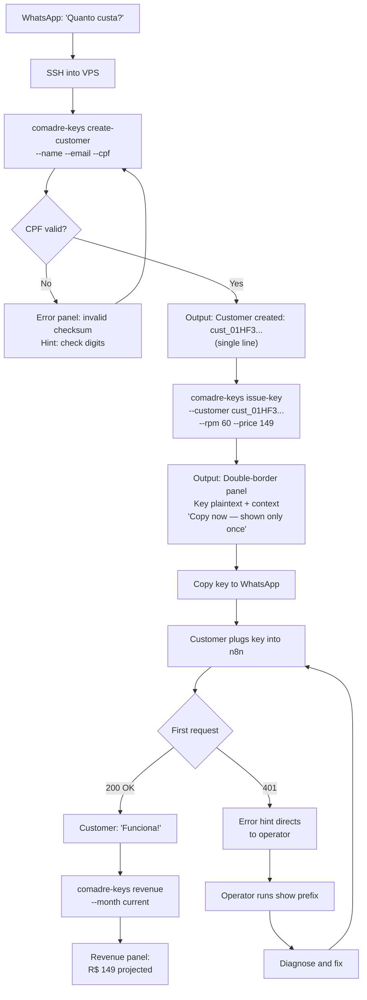
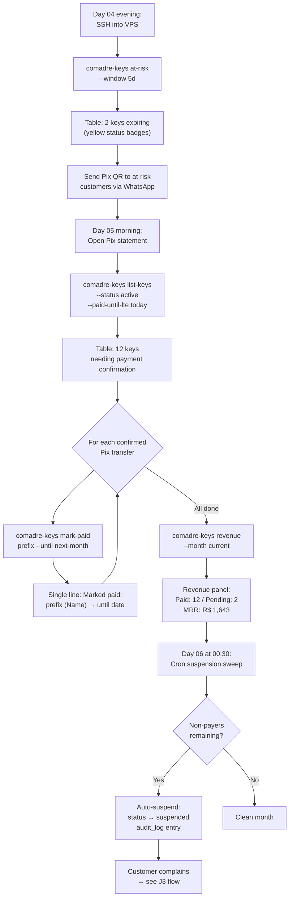
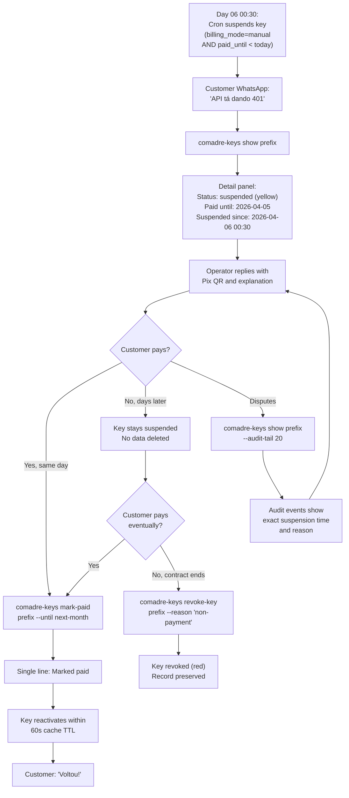
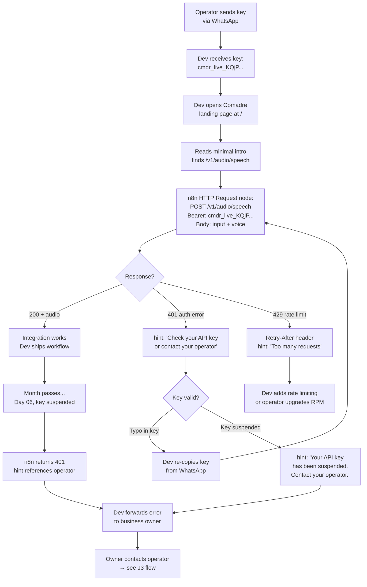

# UX Design Specification — Comadre 2.0.0

**Author:** Galvani
**Date:** 2026-04-15

---

## Executive Summary

### Project Vision

Comadre 2.0.0 adds customer-scoped API-key management and recurring billing to a production TTS API, enabling solo Brazilian developers to resell TTS capacity from a VPS. The entire operator experience is a Typer CLI (`comadre-keys`) accessed over SSH — no web UI, no portal, no login flow. This is a deliberate product thesis: radical operational simplicity as a competitive moat. The customer-facing API contract remains byte-identical to Comadre 1.6.2; the monetization layer is invisible to API consumers.

### Target Users

**Operators (primary UX surface: CLI)**
Brazilian solo developers and small agencies who deploy Comadre on a VPS and resell TTS capacity. Comfortable with SSH and terminal workflows. They need to onboard customers, issue API keys, track payments (Pix/boleto), and monitor revenue — all from the command line, in under 60 seconds per operation.

**Operators' customers (indirect UX surface: API error envelopes)**
Chatbot builders (or their freelance devs) who integrate via n8n HTTP Request nodes. Range from non-technical business owners to experienced developers. They never interact with the monetization layer directly — their experience is shaped entirely by HTTP status codes and error `hint` fields when something goes wrong.

### Key Design Challenges

1. **CLI output as the entire UI.** Every operator interaction — onboarding, billing, troubleshooting, auditing — happens through terminal output. Output density, column selection, color coding, and copy-friendliness determine whether the product feels fast or clunky.
2. **One-shot key display.** The API key plaintext appears exactly once at creation. The display must be unmissable, contextually complete (price, RPM, billing mode, first charge date), and easy to copy into a WhatsApp message.
3. **Error envelopes as customer support.** HTTP 401/429 `hint` fields are the only guidance operators' customers ever see. They must direct the customer to their operator without leaking internal state.
4. **Billing ritual ergonomics.** The monthly day-05 collection workflow (cross-referencing Pix transfers against at-risk keys) must be completable in under 5 minutes for 20 customers. Key-prefix-based commands and scannable table output are critical.

### Design Opportunities

1. **`rich`-formatted CLI as brand differentiator.** Color-coded status badges, box-drawn key displays, and clean table layouts make simplicity feel intentional and professional — not a limitation.
2. **Revenue report as motivation loop.** The `revenue --month current` command is the operator's scoreboard. Paid/pending/projected splits create immediate feedback on business growth.
3. **Key prefix as universal handle.** The 8-character `cmdr_li...` prefix becomes a shared language between operator, customer, CLI, and bank statements — the single identifier that ties all workflows together.
4. **Audit tail as instant forensics.** `show --audit-tail` converts customer support from "let me check" (minutes) to "I see your last 20 requests" (seconds), building operator confidence and customer trust.

## Core User Experience

### Defining Experience

The operator's relationship with Comadre 2.0.0 has two modes: **high-frequency ritual** and **event-driven response**.

**High-frequency ritual (monthly):** The billing cycle. Day 04: `at-risk --window 5d` to preview. Day 05: `list-keys --paid-until-lte today` cross-referenced against Pix statement, then `mark-paid <prefix> --until <date>` per confirmed transfer. Day 06: cron handles non-payers. This ritual must be completable in under 5 minutes for 20 customers.

**Event-driven response (ad hoc):** Customer onboarding (`create-customer` + `issue-key`), troubleshooting (`show --audit-tail`), tier changes (`update-key --rpm --price`), and LGPD requests (`export-customer`, `delete-customer --hard`). Each event is a standalone CLI session — fast in, fast out.

The core UX insight: **the CLI is not a dashboard to monitor. It is a tool to act.** The operator opens a terminal with a specific intent, executes 1-3 commands, and closes the session. Design for action speed, not information browsing.

### Platform Strategy

**Primary platform:** SSH terminal (bash/zsh). Keyboard-only input. No mouse, no touch, no browser-based interface.

**Display constraints:**
- Minimum 80-column terminal width assumed. Tables must be readable at 80 columns; wider terminals get more detail, not wider gutters.
- Color support via `rich` library: 256-color minimum, with graceful fallback to no-color (`--no-color` flag and `NO_COLOR` env var support).
- Unicode box-drawing characters for key display panels. Fallback to ASCII borders for legacy terminals.

**Output modes:**
- Human-readable (default): `rich`-formatted tables, panels, and status badges for interactive use.
- Machine-readable (`--format json`): NDJSON or JSON array for scripting, piping to `jq`, and external automation.
- YAML (`--format yaml`): for `export-customer` LGPD responses.

**No offline consideration.** The CLI reads from SQLite on the VPS; the operator is always SSH'd in. No local caching, no sync, no offline mode.

### Effortless Interactions

**Key prefix as universal handle.** Every command that references a key accepts the 8-character prefix (`cmdr_li...`) instead of a full identifier. Tab completion via Typer's shell integration resolves ambiguous prefixes. The prefix appears in CLI output, error envelopes, and audit logs — it is the lingua franca between operator, customer, and system.

**`mark-paid` hot path.** The most frequent command in steady-state operation. Must accept a prefix and a date, execute in under 200ms, and print a single confirmation line. No interactive prompts, no confirmation dialogs, no multi-step wizards. The operator is in flow: read Pix statement, type prefix, type date, enter, next.

**Zero-touch suspension.** The daily cron sweep at 00:30 operator TZ handles all billing enforcement. The operator never manually suspends for non-payment — the system does it. Manual `suspend` exists for out-of-cycle interventions (abuse, contract disputes), not for routine billing.

**Status badges at a glance.** Every `list-*` and `show` command uses color-coded status indicators: green for active, yellow for suspended, red for revoked, blue for complimentary. The operator scans a table of 20 keys and immediately knows the portfolio state without reading individual cells.

### Critical Success Moments

1. **First key issued (J1).** The operator runs `issue-key`, sees the one-shot key display with all context (prefix, RPM, price, first charge date), copies it into WhatsApp, and the customer confirms it works within minutes. This is the "primeira venda" moment — revenue becomes real.

2. **First revenue report (J2).** `revenue --month current` shows paid customers, pending, projected total. The operator takes a screenshot and shares it. The number on screen is the proof that the business model works.

3. **Instant forensics (J5).** A customer complains about "401 errors." The operator runs `show <prefix> --audit-tail 20`, sees it's actually 429s (rate-limit bursts, not auth failures), and resolves the issue in the same WhatsApp conversation — while the customer is still typing.

4. **Self-healing billing (J2/J3).** A non-payer is auto-suspended by cron. They pay two days later. The operator runs `mark-paid`, and the key reactivates within the 60-second cache TTL. The system handled enforcement and recovery without operator stress.

## Desired Emotional Response

### Primary Emotional Goals

**Confident control.** The operator must feel like a business owner using a professional tool — not a sysadmin fighting a system. The CLI reinforces agency: the operator decides who gets access, at what price, and when to cut it off. The tool executes; the operator commands.

**Invisible competence.** The operator's customer should feel nothing unusual. The API works. The key authenticates. When something goes wrong, the error tells them exactly who to contact. The monetization layer is invisible when things work, and helpful when they don't.

### Emotional Journey Mapping

| Stage | Desired Emotion | Design Response |
|---|---|---|
| First discovery | "Simpler than expected" | Minimal CLI surface; `--help` on every command with actionable examples |
| First customer onboarded | Empowerment | One-shot key display with full context; immediate confirmation of working key |
| Monthly billing ritual | Efficient flow state | `mark-paid` in 3-4 seconds per customer; no prompts, no confirmation |
| Revenue report | Pride and momentum | Clear paid/pending/projected split; total in bold; currency right-aligned |
| Customer complaint | Instant competence | `show --audit-tail` answers the question before the customer finishes typing |
| Auto-suspension by cron | Calm delegation | Zero operator action required; `at-risk` gives advance warning |
| CLI error | Clarity | Every error includes a `hint` with the corrective action |
| Customer sees 401 | Directed, not abandoned | `hint` field names the operator's contact; no internal state leaked |

### Micro-Emotions

**Confidence through predictability.** Commands always produce the same output shape for the same data. Column order, color coding, and status badges are invariant. The operator builds muscle memory, not coping strategies.

**Trust through traceability.** Revenue numbers are not opaque totals — they decompose into individual keys. The operator can drill from `revenue` → `list-keys --status active` → `show <prefix>` to verify any number. Trust is earned by transparency, not assertion.

**Accomplishment through velocity.** The `mark-paid` hot path is designed for speed. Each confirmation prints in under 200ms. The operator processes 12 customers and feels momentum, not tedium. The billing ritual is a 5-minute sprint, not a 30-minute chore.

**Calm through safety fencing.** Destructive commands require `--yes` or interactive confirmation. Routine commands never ask permission. The operator knows: if the CLI asks "are you sure?", this action is irreversible. If it doesn't ask, it's safe. The boundary is unambiguous.

### Design Implications

| Emotional Goal | UX Design Decision |
|---|---|
| Confident control | Key prefix as the universal handle; operator never needs to look up an ID |
| Invisible competence | API contract byte-identical to 1.6.2; 401 hints configurable via `OPERATOR_CONTACT_HINT` |
| Efficient flow | `mark-paid` accepts prefix + date, no intermediate steps; `at-risk` pre-filters the work |
| Pride and momentum | `revenue` output uses `rich` panel with bold totals and color-coded status counts |
| Instant competence | `show --audit-tail N` combines key context + recent events in a single output |
| Calm delegation | Cron suspension is automatic; `health` command confirms cron liveness |
| Clarity on error | Every `ComadreError` subclass carries a `hint`; CLI errors use `rich` error panels |
| Directed, not abandoned | 401 `hint` references operator contact without revealing key status to unauthenticated callers |

### Emotional Design Principles

1. **Speed is an emotion.** A command that completes in 200ms feels confident. The same command at 2 seconds feels sluggish. Performance targets (NFR1-NFR7) are emotional design decisions, not just technical ones.

2. **Silence signals safety.** Routine commands print minimal output (one confirmation line). Verbose output is reserved for diagnostic commands (`show --audit-tail`, `health`). The operator learns: short output = everything worked; long output = here's the detail you asked for.

3. **Color carries meaning, never decoration.** Green = active/success. Yellow = suspended/warning. Red = revoked/error. Blue = complimentary/info. These four colors appear consistently across every command. No gradients, no theming, no aesthetic color choices.

4. **Errors are conversations, not dead ends.** Every error — CLI or API — answers three questions: What happened? Why? What should I do next? The `hint` field is the "what next" — it's the most important field in the error envelope.

5. **The screenshot test.** Every operator-facing output should look good in a WhatsApp screenshot. Revenue reports, key displays, and status tables will be shared — they are the operator's proof of business to peers and prospects. `rich` formatting must render cleanly when photographed from a terminal.

### Experience Principles

1. **Action over observation.** The CLI is a tool for executing intents, not a dashboard for monitoring state. Every command should complete a user goal, not present information to browse. When information is shown, it is always in service of a decision or action.

2. **Prefix everywhere.** The key prefix is the only identifier an operator needs to memorize or copy. Full IDs exist in the database; prefixes exist in the workflow. Every command, every display, every error message uses the prefix as the primary handle.

3. **Scannable in 2 seconds.** Any table or report output must communicate its essential message within 2 seconds of visual scanning. Color-coded badges, right-aligned currency columns, and consistent column ordering enable this. If the operator has to read cell-by-cell, the output design has failed.

4. **No ceremony for routine actions.** High-frequency commands (`mark-paid`, `list-keys`, `show`, `at-risk`) have zero interactive prompts and zero confirmation dialogs. Destructive commands (`delete-customer --hard`, `revoke-key`, `rotate-encryption-key`) require explicit `--yes` or interactive confirmation — but these are rare events, not daily ritual.

5. **Errors guide action.** Every error — CLI-side or API-side — includes a `hint` field that tells the recipient what to do next. CLI errors tell the operator how to fix the command. API 401 errors tell the customer to contact their operator. No error should leave the reader wondering "what now?"

## UX Pattern Analysis & Inspiration

### Inspiring Products Analysis

**Stripe CLI** — Proves that a CLI can be the primary interface for financial operations. Key lessons: predictable noun-verb subcommand grammar (`stripe customers create`), clean one-shot secret display with "copy now" warning, human-readable tables as the default output with `--json` for scripting. Stripe's CLI feels authoritative because it is consistent: every `list` command produces the same column structure, every `create` command returns the new object's ID and key fields.

**GitHub CLI (`gh`)** — Demonstrates the dual-output-mode pattern at scale. `gh pr list` shows a human-scannable table; `gh pr list --json` gives structured data. The `--jq` flag enables inline extraction without external tools. For Comadre, the takeaway is: never make the operator choose between readability and scriptability — offer both, default to human.

**Docker CLI** — The operator's existing mental model. `docker ps` = list with status badges. `docker inspect` = deep detail on one entity. `docker logs --tail N` = recent events. These patterns map directly to `list-keys`, `show`, and `show --audit-tail`. The familiarity reduces learning curve to near zero.

### Transferable UX Patterns

**Command structure patterns:**
- Noun-verb subcommands: `create-customer`, `issue-key`, `mark-paid` — follows the Stripe/Heroku convention the audience already knows
- Positional arguments for the primary target (key prefix or customer ID), named flags for modifiers (`--rpm`, `--price`, `--until`)
- `--help` on every subcommand with a realistic example (not abstract placeholders)

**Output patterns:**
- Human-readable tables by default with `rich.table.Table` — column headers, row borders, status badges
- `--format json` for machine consumption — NDJSON for streaming, JSON array for batch
- Single-entity display (`show`) uses `rich.panel.Panel` with labeled fields, not a one-row table
- One-shot secrets (key plaintext) use a high-contrast `rich.panel.Panel` with double-line border and explicit "copy now — shown only once" warning

**Interaction patterns:**
- Key prefix as the primary identifier everywhere (like Docker container short IDs)
- No interactive prompts for routine commands; `--yes` flag for destructive commands (like `docker system prune --force`)
- Exit code 0 on success, non-zero on error — scripts can test `$?` without parsing output
- Error output on stderr, data output on stdout — enables `comadre-keys list-keys --format json 2>/dev/null | jq`

### Anti-Patterns to Avoid

- **JSON-by-default output (AWS CLI pattern).** Forces human users to pipe through `jq` for basic readability. Comadre defaults to human-readable; JSON is opt-in via `--format json`.
- **Deep flag nesting (kubectl pattern).** Routine queries should need 0-2 flags. `list-keys` with no flags shows all active keys. `list-keys --status suspended` adds one filter. Never require 4+ flags for a common operation.
- **TUI / live dashboard (htop/lazydocker pattern).** The operator SSHs in, runs a command, reads output, acts. No curses UI, no live-updating panels, no split-pane layouts. The CLI is stateless between invocations.
- **Interactive wizards for high-frequency commands (npm init pattern).** `mark-paid` is run 20 times per billing cycle. It must be a one-liner: `comadre-keys mark-paid <prefix> --until 2026-06-05`. No step-by-step prompts.
- **Ambiguous exit codes.** Every non-zero exit must map to a specific error category. Scripts that automate `comadre-keys` must be able to distinguish "key not found" from "database unreachable" without parsing stderr text.

### Design Inspiration Strategy

**Adopt directly:**
- Stripe's one-shot secret display with "copy now" warning → `issue-key` output
- Docker's short-ID pattern → key prefix as universal handle
- `gh`'s dual output mode → human default + `--format json`
- Stripe's noun-verb subcommand grammar → `create-customer`, `issue-key`, `mark-paid`

**Adapt for Comadre's context:**
- Stripe's `--expand` flag (show nested objects inline) → `show --audit-tail N` (show recent events inline with key detail)
- Docker's color-coded status → simplified to 4 colors only (green/yellow/red/blue) for terminal accessibility
- `gh`'s `--jq` inline filter → not in MVP; operators who need filtering use `--format json | jq` directly

**Reject explicitly:**
- AWS CLI's JSON-first philosophy → conflicts with "scannable in 2 seconds" principle
- kubectl's namespace/selector complexity → the operator manages one shard at a time; no multi-context switching
- Any TUI or live-mode pattern → conflicts with "action over observation" principle
- Interactive wizards for routine commands → conflicts with "no ceremony for routine actions" principle

## Design System Foundation

### Design System Choice

**`rich` library as the terminal design system.** Comadre has no visual UI; the design system is the Python `rich` library (already a Typer transitive dependency) combined with a strict 4-color semantic palette and output structure conventions. This is not a compromise — it is the correct design system for a CLI-first product.

### Rationale for Selection

- **Already in the dependency tree.** Typer uses `rich` internally; adding it as the rendering layer introduces zero new dependencies.
- **Comprehensive terminal rendering.** Tables, panels, trees, progress bars, syntax highlighting, JSON pretty-printing — all in one library.
- **Graceful degradation.** `rich` respects `NO_COLOR` environment variable and detects terminal width. Narrow terminals get truncated columns, not broken layouts.
- **Accessibility.** `rich` supports screen readers via semantic markup. Color is never the sole carrier of meaning — status badges include text labels alongside color.
- **Alternatives rejected.** `tabulate` (tables only, no panels), `blessed`/`curses` (TUI conflicts with stateless command principle), plain ANSI codes (reinvents what `rich` provides), raw `print()` (violates project conventions).

### Implementation Approach

**Component mapping:**

| `rich` Component | Comadre Use Case | Commands |
|---|---|---|
| `Table` | Multi-row listings with sortable columns | `list-customers`, `list-keys`, `at-risk` |
| `Panel` (double border, high contrast) | One-shot secret display — the key creation moment | `issue-key`, `rotate-key` |
| `Panel` (single border) | Single-entity detail view and summary reports | `show`, `revenue`, `health` |
| Inline `Text` with style markup | Status badges within tables and detail views | All commands displaying status |
| Plain `Text` | Single-line confirmations for fast commands | `mark-paid`, `suspend`, `reactivate` |
| `Console.print_json()` | Machine-readable output mode | Any command with `--format json` |
| `Panel` (red border) | Error display with hint | All error conditions |

**Shared `Console` instance:**

A single `rich.console.Console` instance, configured once, used by all commands:
- `stderr` console for errors (enables `stdout` to be piped cleanly)
- `width` auto-detected from terminal; minimum 80 columns assumed
- `NO_COLOR` and `--no-color` flag respected globally
- `force_terminal=True` never set — let `rich` auto-detect

### Customization Strategy

**Semantic color palette (4 colors, invariant):**

| Color | Semantic Meaning | `rich` Style | Used In |
|---|---|---|---|
| Green | Active / Success / Paid | `[green]` | Status badges, confirmation messages, paid counts |
| Yellow | Suspended / Warning / Pending | `[yellow]` | Status badges, at-risk warnings, pending counts |
| Red | Revoked / Error / Overdue | `[red]` | Status badges, error panels, CLI errors |
| Blue | Complimentary / Info / Neutral | `[blue]` | Complimentary status, informational messages |

**Table conventions (invariant across all `list-*` commands):**

- Column order: identifier → name → status → billing fields → dates
- Status column always uses color-coded badge text
- Currency columns right-aligned with `R$` prefix
- Date columns in `YYYY-MM-DD` format (ISO 8601, sortable)
- Table title shows the filter applied (e.g., "Active Keys" vs. "All Keys")
- Row count shown below the table (e.g., "3 keys found")

**Panel conventions:**

- One-shot secrets: double-line border, bold key text, explicit "copy now — shown only once" warning, contextual fields (prefix, RPM, price, billing mode, first charge date)
- Detail views (`show`): single-line border, labeled key-value pairs, optional audit tail appended below
- Revenue reports: single-line border, summary fields with bold totals, separator between paid/pending/projected sections
- Errors: red single-line border, `message` as title, `hint` as body text

## Defining Interaction

### The Defining Experience

**"SSH in, issue a key, paste it on WhatsApp — first sale in 20 minutes."**

The defining interaction is not a single command but a 3-command sequence that converts an operator from "someone who runs a TTS server" to "someone who sells TTS":

```text
comadre-keys create-customer --name "Helena Ribeiro" --email "helena@clinica.com" --cpf "123.456.789-00"
comadre-keys issue-key --customer cust_01HF3... --rpm 60 --price 149
# Copy key → paste on WhatsApp → customer confirms "funciona!"
```

This sequence is the product's proof of concept. If it takes 60 seconds and feels effortless, the operator will do it again. If it takes 10 minutes or feels fragile, they'll go back to sharing a single `API_KEY`.

### User Mental Model

The operator's mental model is **key vendor**, not **system administrator**:

| Operator thinks... | System concept | CLI surface |
|---|---|---|
| "I have 20 keys out" | `api_key` table, `status=active` | `list-keys` |
| "18 are paid up" | `paid_until >= today` | `list-keys --paid-until-lte today` (inverse: who owes me?) |
| "Helena's key does 60 per minute" | `rate_limit_rpm=60` | `show <prefix>` |
| "I made R$1,600 this month" | SUM of `price_monthly` WHERE paid | `revenue --month current` |
| "Marcos didn't pay, cut him off" | `status=suspended` via cron | Automatic — or `suspend <prefix>` for manual |
| "He paid, turn it back on" | `mark-paid` extends `paid_until` | `mark-paid <prefix> --until 2026-06-05` |

The CLI vocabulary mirrors this mental model: `issue-key` (not `create-api-key-record`), `mark-paid` (not `update-payment-status`), `at-risk` (not `query-keys-approaching-expiration`). Command names are business verbs, not database operations.

### Success Criteria

The defining experience succeeds when:

1. **First-sale completion in under 60 seconds** (from `create-customer` to key copied). The operator has never used the CLI before; the `--help` examples are enough.
2. **Zero lookup friction.** The operator never needs to scroll back or run a second command to find an ID. `create-customer` prints the customer ID. `issue-key` prints the key and prefix. `show` accepts the prefix.
3. **Copy-paste fidelity.** The key plaintext in the `issue-key` panel can be triple-click-selected (whole line) or manually selected without grabbing border characters. The key is on its own line, with no leading/trailing decorations that would break the copy.
4. **Immediate validation.** The customer uses the key within minutes and it works. No provisioning delay, no cache warming, no "wait 5 minutes." The key is active the instant it's issued.
5. **Repeatable confidence.** The 10th time the operator issues a key, it feels faster than the 1st time. Muscle memory builds because the command structure is invariant.

### Pattern Analysis

**100% established patterns, zero novel UX.** Every interaction maps to a tool the operator already uses:

| Comadre Interaction | Established Pattern Source | Why it works |
|---|---|---|
| `issue-key` → one-shot secret display | Stripe API key creation | Operators who've used Stripe recognize the pattern instantly |
| `list-keys` → status table | `docker ps` | Color-coded status badges, columnar layout, familiar |
| `show <prefix>` → detail view | `docker inspect` (but human-readable) | Single-entity deep dive with labeled fields |
| `mark-paid <prefix>` → one-line confirmation | `git commit` | Fast, decisive, minimal output on success |
| `revenue` → summary panel | Bank statement / financial report | Paid/pending/projected splits are universally understood |
| `at-risk` → filtered warning list | CI failure summary | "Here are the things that need your attention" |
| `--format json` → machine output | `gh --json` | Opt-in structured data for scripting |

The innovation is the *combination*: nobody has packaged billing + key management + TTS in a CLI for Brazilian solo operators. But each individual interaction is a pattern the audience already knows. This means zero onboarding friction — the operator reads `--help` once and is productive.

### Experience Mechanics

**1. Initiation — The operator has a customer to onboard:**

The trigger is a WhatsApp message: "Quanto custa pra usar o teu TTS?" The operator SSHs into the VPS (already a habitual action for this persona) and runs `comadre-keys create-customer`.

- Input: `--name`, `--email`, `--cpf` or `--cnpj` (required), `--notes` (optional)
- Validation: CPF/CNPJ checksum runs immediately; invalid input rejected with a clear error before any record is created
- Output: single line — `Customer created: cust_01HF3... (Helena Ribeiro)`

**2. Interaction — Issue the key:**

The operator runs `comadre-keys issue-key --customer cust_01HF3... --rpm 60 --price 149`.

- Input: customer ID (from the previous command's output), RPM limit, monthly price
- Processing: key generated, hash stored, plaintext prepared for display
- Output: high-contrast `rich.Panel` with double border containing:
  - The plaintext key on its own line (copy-friendly)
  - "Copy now — shown only once" warning
  - Summary: prefix, RPM, price, billing mode, first charge date
- The key is immediately active in the auth cache

**3. Feedback — Customer confirms:**

The operator pastes the key into WhatsApp. The customer (or their dev) plugs it into an n8n HTTP Request node. The first request succeeds with 200 OK. The customer replies: "Funciona!"

- No system feedback needed at this stage — the API's 200 response IS the feedback
- If the customer gets a 401, the `hint` field directs them back to the operator

**4. Completion — Revenue is real:**

The operator runs `comadre-keys list-customers` and sees one row. Or `comadre-keys revenue --month current` and sees R$149 projected. The defining experience is complete: the operator has a paying customer, managed entirely from the terminal.

- The "done" signal is the revenue number on screen
- Next action is either: onboard another customer, or wait for day 05

## Visual Design Foundation

### Color System

**4-color semantic palette (defined in Design System Foundation, formalized here):**

| Token | `rich` Style | ANSI Equivalent | Semantic Meaning | Usage Frequency |
|---|---|---|---|---|
| `status.active` | `[green]` | ANSI 32 | Active, success, paid, healthy | High — most keys are active |
| `status.suspended` | `[yellow]` | ANSI 33 | Suspended, warning, pending, at-risk | Medium — billing cycle events |
| `status.revoked` | `[red]` | ANSI 31 | Revoked, error, overdue, critical | Low — rare lifecycle events |
| `status.complimentary` | `[blue]` | ANSI 34 | Complimentary, info, neutral | Low — bundled contracts |

**Color usage rules:**

- Color is always paired with text. `[green]active[/green]` never appears as `[green]●[/green]` alone — the word is the primary carrier of meaning, color is the accelerator.
- Background colors are never used. Terminal background varies per user (dark/light themes); foreground-only colors ensure readability on both.
- Bold is reserved for emphasis within panels (key plaintext, revenue totals), never for status badges (bold + color = visual noise in tables).
- `NO_COLOR` compliance: when `NO_COLOR` env var is set or `--no-color` flag is passed, all styling is stripped. Output remains fully functional — status is readable from the text alone.

**Accessibility (terminal context):**

- ANSI basic colors (30-37) are used instead of 256-color or RGB values. Basic colors are universally remapped by terminal themes (Solarized, Dracula, Nord, etc.) to maintain contrast against the user's chosen background.
- No ANSI bright variants (90-97) — they behave inconsistently across terminal emulators.
- The 4-color palette was chosen because green/yellow/red/blue have distinct hue separation even under common forms of color vision deficiency (deuteranopia, protanopia). Yellow and blue are safe across all types; red and green are disambiguated by the text label.

### Typography System

**Monospace only.** The terminal enforces monospace rendering; there is no font choice. The "typography system" is how we use character alignment and whitespace within that constraint.

**Character alignment conventions:**

| Element | Alignment | Rationale |
|---|---|---|
| Identifiers (prefix, customer ID) | Left | Read left-to-right as the first thing the eye hits |
| Names (customer name) | Left | Natural reading order |
| Status badges | Left | Consistent scan column |
| Currency values (R$ amounts) | Right | Decimal alignment for quick comparison |
| Dates (YYYY-MM-DD) | Left | ISO 8601 is fixed-width; left-align is sufficient |
| Counts (RPM, request stats) | Right | Numeric comparison |

**Text density conventions:**

- Table rows: no blank lines between rows (standard `rich.Table` behavior)
- Between output sections: one blank line
- Panel content: no leading/trailing blank lines inside the panel border
- Confirmation messages: single line, no blank line after (the shell prompt provides the visual separator)
- Error panels: `message` as panel title, `hint` as body — no additional spacing needed

### Spacing & Layout Foundation

**Terminal width strategy:**

- Minimum: 80 columns. Tables are designed to fit at 80 columns with abbreviated column headers if needed.
- Optimal: 120 columns. Tables show full column headers and wider content columns.
- Maximum: no cap. `rich` auto-expands tables to terminal width, but column widths are bounded by content, not stretched to fill.
- Detection: `rich.Console` auto-detects terminal width. No manual override.

**Table layout rules:**

- Maximum 7 columns in any `list-*` table at 80-column width. If more data is needed, use `show` for the detail view.
- Column priority (if truncation is needed): identifier > status > name > billing fields > dates. The rightmost column is truncated first.
- No horizontal scrolling — if content doesn't fit, it wraps within the cell (single-line wrap, not multi-line).

**Panel layout rules:**

- One-shot key display (`issue-key`): double-line border, full terminal width, key on a dedicated line with no leading whitespace (enables triple-click selection).
- Detail views (`show`): single-line border, key-value pairs with consistent label width (right-padded to the longest label in the panel).
- Revenue reports: single-line border, sections separated by a `rich` horizontal rule (`─────`), bold totals.

**Output structure for compound commands (`show --audit-tail N`):**

```text
┌─ Key: cmdr_li... ──────────────────────┐
│ Customer:    Helena Ribeiro (cust_01HF3)│
│ Status:      active                     │
│ RPM:         60/min                     │
│ Price:       R$ 149,00/month            │
│ Billing:     manual                     │
│ Paid until:  2026-06-05                 │
│ Created:     2026-04-15                 │
│ Last used:   2026-05-12 14:23:45        │
└─────────────────────────────────────────┘

Last 5 events:
  2026-05-12 14:23:45  AUTH_SUCCESS   203.0.113.45
  2026-05-12 14:20:12  AUTH_SUCCESS   203.0.113.45
  2026-05-05 08:00:01  MARK_PAID     cli:galvani
  2026-04-15 10:30:00  ISSUE_KEY     cli:galvani
  2026-04-15 10:29:45  CREATE_CUST   cli:galvani
```

Detail panel first (the context), audit tail second (the events). The operator reads top-down: "who is this?" → "what happened?"

### Accessibility Considerations

**Terminal accessibility is constrained but addressable:**

- **Screen readers:** `rich` outputs semantic text. Status badges are text labels (`active`, `suspended`), not symbols. Screen readers can parse the output linearly.
- **High contrast:** foreground-only colors on the user's chosen background. No low-contrast combinations (e.g., no gray-on-black or light-blue-on-white).
- **Color vision deficiency:** 4-color palette uses hue-separated pairs. Every color is paired with a text label. No information is conveyed by color alone.
- **`NO_COLOR` standard:** full compliance. When set, all `rich` styling is stripped. Output degrades to plain text with identical information content.
- **Large text:** terminal font size is user-controlled. No fixed sizing in the application.
- **Keyboard-only:** inherent — CLI is keyboard-only by definition. No mouse interactions to accommodate.

## Design Direction Decision

### Design Directions Explored

Comadre has no visual UI to mockup in HTML. The "design directions" are the CLI output templates — the 6 output types that define every operator interaction. Each was designed as a text-based mockup showing the exact terminal rendering the operator will see.

The 6 output types are:
1. **One-shot key panel** (`issue-key`, `rotate-key`) — double-border panel, highest visual weight
2. **Status table** (`list-keys`, `list-customers`, `at-risk`) — columnar data with color-coded badges
3. **Summary report** (`revenue`) — bordered panel with sections and bold totals
4. **Detail view** (`show`) — single-border panel with labeled key-value pairs
5. **Minimal confirmation** (`mark-paid`, `suspend`, `reactivate`) — single line, no panel
6. **Error panel** (all error conditions) — red-bordered panel with message and hint

### Chosen Direction

**Single direction — no alternatives needed.** Unlike visual UI where multiple aesthetic directions compete, CLI output has one correct rendering per output type. The direction is defined by the conventions established in prior steps:

- Double-border panels for secrets (unmissable, high-contrast)
- Single-border panels for detail views and reports (contextual, lower visual weight)
- Tables for multi-row data (scannable, filterable, sortable by column)
- Single-line text for confirmations (fast, no-ceremony)
- Red-border panels for errors (distinct from all other output types)

### Design Rationale

The output hierarchy follows visual weight:

```text
Double-border panel (issue-key)  ←  highest attention
Single-border panel (show, revenue)
Table (list-keys, at-risk)
Single line (mark-paid)          ←  lowest attention (routine)
Red-border panel (errors)        ←  interrupts regardless of context
```

This hierarchy matches the emotional journey: the key creation moment demands maximum attention (one-shot, non-retrievable). The billing ritual demands minimum friction (one line per `mark-paid`). Errors demand re-engagement (red border interrupts the flow to demand correction).

### Implementation Approach

**CLI output mockups as specifications:**

Each output type is defined by a text mockup that serves as the implementation reference. The developer matches the `rich` component usage to the mockup character-by-character:

| Output Type | `rich` Implementation | Key Constraint |
|---|---|---|
| One-shot key panel | `Panel(content, border_style="double", title="API KEY ...")` | Key plaintext on its own line, no leading whitespace |
| Status table | `Table(title="Active Keys")` with styled status cells | Max 7 columns at 80-col width |
| Summary report | `Panel(content, title="Revenue Report — ...")` with `Rule()` separators | Bold totals via `[bold]R$ ...[/bold]` |
| Detail view | `Panel(content, title="Key: cmdr_li...")` | Labels right-padded to longest label width |
| Confirmation | `Console.print("Marked paid: ...")` | Single line, exit 0 |
| Error panel | `Panel(content, border_style="red", title="Error")` on stderr | `hint` always present; exit non-zero |

## User Journey Flows

### J1 — First Sale Flow

The operator's first customer onboarding, from WhatsApp inquiry to working key.



**UX decisions in this flow:**
- `create-customer` outputs a single line (minimal — the operator's next action is `issue-key`, not reading a report)
- `issue-key` outputs the highest-weight panel (double border — this is the most important output in the entire CLI)
- The key plaintext is on its own line for triple-click copy
- If the customer hits a 401, the `hint` field closes the loop back to the operator

### J2 — Monthly Billing Ritual Flow

The day-04-through-day-06 billing cycle for a portfolio of customers.



**UX decisions in this flow:**
- `at-risk` uses yellow badges — warning, not error. The operator has time to act.
- `list-keys --paid-until-lte today` is the "who owes me?" query — the most important filter in steady state
- `mark-paid` is the hot path: single-line output, no panel, no confirmation dialog. The operator is in flow.
- `revenue` is the reward moment — a bordered panel with bold totals
- Cron suspension is zero-touch — no CLI interaction required

### J3 — Delinquent Customer Flow

A customer's key is suspended, they complain, operator resolves.



**UX decisions in this flow:**
- `show` gives the operator everything they need to explain the situation to the customer: status, dates, price, age
- The 401 error `hint` (customer-facing) says "Contact your Comadre operator for billing resolution" — directs without leaking suspension details
- `mark-paid` is the same one-line command regardless of whether it's a routine payment or a post-suspension reactivation
- `--audit-tail` provides evidence if the customer disputes ("your key was suspended by the daily sweep at 00:30 on 2026-04-06")

### J4 — Customer API Integration Flow

The indirect user experience — a customer's dev integrating the key.



**UX decisions in this flow:**
- The API contract is byte-identical to 1.6.2 — the dev doesn't know monetization exists
- The 401 `hint` for suspended keys names the operator's contact (configurable via `OPERATOR_CONTACT_HINT`)
- The 401 for invalid keys does NOT reveal whether the key was ever valid (enumeration resistance)
- 429 responses include `Retry-After` — actionable without contacting anyone
- The landing page at `/` works identically with or without monetization

### Journey Patterns

**Patterns consistent across all flows:**

| Pattern | Description | Used In |
|---|---|---|
| **Prefix-driven lookup** | Every key-targeting command accepts the 8-char prefix | J1, J2, J3 |
| **Single-line confirmation** | Mutation commands print one line on success | J2 (mark-paid), J3 (mark-paid, revoke) |
| **Panel for context** | Detail views use bordered panels with labeled fields | J1 (issue-key), J3 (show) |
| **Table for comparison** | Multi-row queries use columnar tables with status badges | J2 (list-keys, at-risk) |
| **Hint-guided errors** | Every error includes actionable next step | J1, J3, J4 |
| **Zero-touch automation** | Cron handles enforcement; operator handles exceptions | J2 (suspension), J3 (trigger) |

### Flow Optimization Principles

1. **Minimize round-trips.** `create-customer` prints the customer ID that `issue-key` needs. `show` combines detail + audit tail in one command. The operator never runs a command just to get an ID for the next command.

2. **Match output weight to action frequency.** High-frequency `mark-paid` → single line. Low-frequency `issue-key` → full panel. The operator's eyes calibrate to the output weight: if they see a panel, something important happened; if they see a line, the routine action succeeded.

3. **Error recovery is always one command away.** Customer complaint → `show prefix`. Billing dispute → `show prefix --audit-tail 20`. Rate-limit issue → `show prefix --audit-tail 20` (same command, different diagnosis). The operator doesn't need to choose a different diagnostic tool for different problems.

4. **The API error hint closes the loop.** Every 401 `hint` directs the customer to their operator. The operator is always the resolution path — no support portal, no ticketing system, no email queue. WhatsApp is the implicit support channel, and the `hint` field is the bridge.

## Component Strategy

### Design System Components

**`rich` library provides these foundation primitives:**

| `rich` Primitive | Capability | Used Directly? |
|---|---|---|
| `Table` | Columnar data with headers, borders, alignment | Wrapped — needs Comadre column conventions |
| `Panel` | Bordered content box with title | Wrapped — needs border style and content conventions |
| `Text` | Styled inline text | Used directly for status badges |
| `Console` | Output orchestration, width detection, color control | Used directly as singleton |
| `Rule` | Horizontal separator | Used directly inside panels |
| `JSON` | JSON pretty-printing | Used directly for `--format json` |

**Gap: `rich` provides primitives, not Comadre-specific output patterns.** Every command needs a custom output helper that assembles `rich` primitives according to the conventions defined in this spec.

### Custom Components

#### KeyPanel

**Purpose:** Display a newly created or rotated API key with full context. The most critical output component — shown once per key creation, never again.

**Layout (industry-standard three-piece design):**

Follows the convention established by AWS IAM console, GitHub Personal Access Tokens, and Stripe live-key reveal: a warning header, the secret on a bare line, and contextual metadata below. The plaintext is deliberately OUTSIDE any bordered panel — wrapping it inside a Panel would flank it with vertical border glyphs (`║`) that break triple-click selection (UX-DR17).

```
╔═ API KEY (copy now — shown only once) ═╗
║ Copy the key below now. It is the last ║
║ time it will be shown — there is no    ║
║ way to recover it.                     ║
╚════════════════════════════════════════╝
cmdr_live_XXXXXXXXXXXXXXXXXXXXXXXXXXXXXXXXXXXXXXXXXXX

╔══════════════════════════════════════════════════╗
║ prefix:        XXXXXXXX                          ║
║ customer:      <name> (cust_<ulid>)              ║
║ rate limit:    60/min                            ║
║ billing mode:  manual                            ║
║ price:         R$ 149,00/month                   ║
║ first charge:  2026-05-05 (22 days free ...)     ║
╚══════════════════════════════════════════════════╝
```

1. **Warning Panel** — `box.DOUBLE`, title `"API KEY (copy now — shown only once)"`, body is the single-sentence warning.
2. **Naked plaintext line** — column 0, no border chars, no label, no wrapping (`no_wrap=True`, `overflow="ignore"`, `crop=False`). Guarantees triple-click selection copies only the key on any terminal width.
3. **Blank line** — visual separation between the copyable secret and the metadata block.
4. **Context Panel** — `box.DOUBLE`, labeled key/value rows. Labels right-padded to the longest label width (`billing mode:` / `first charge:` = 13 chars).

**States:**
- `manual` billing mode: shows `price: R$ <amount>/month` (pt-BR format: dot-thousands, comma-decimal, e.g. `R$ 1.234,56`) and `first charge: YYYY-MM-DD (N days free until then)`.
- `complimentary` billing mode: shows `price: R$ 0,00 (bundled externally)` and `paid until: — (not applicable)` (em-dash U+2014).

**Design rationale — DO NOT wrap the plaintext in a Panel.** Earlier drafts of AC1 said "plaintext on its own line at the panel content's column 0, inside the border". That wording contradicts UX-DR17: any Rich `Panel` renders vertical border characters flanking its content, which triple-click selects along with the key. The three-piece layout resolves the tension by placing the plaintext between two panels rather than inside one. Future refactors MUST preserve this structure.

**Accessibility:** Key plaintext is on its own line so screen readers announce it as a distinct element. Warning Panel precedes the key in reading order; Context Panel follows.

#### StatusTable

**Purpose:** Display a filtered list of keys or customers with color-coded status badges. Used by `list-keys`, `list-customers`, `at-risk`.

**Content:**
- Columns follow the invariant order: identifier → name → status → billing fields → dates
- Status cells use color-coded text: `[green]active[/]`, `[yellow]suspended[/]`, `[red]revoked[/]`, `[blue]complem.[/]`
- Currency right-aligned with `R$` prefix
- Row count shown below the table

**Variants:**
- `list-keys`: prefix, customer name, status, price, paid until
- `list-customers`: customer ID, name, email, key count, registered date
- `at-risk`: prefix, customer name, price, paid until, days left

**States:**
- Empty result: "No keys found" (not an error panel — it's a valid state)
- Filtered: table title reflects the filter (e.g., "Suspended Keys", "At-Risk Keys (next 5 days)")

**`rich` assembly:** `Table(title=..., show_lines=False)` with `add_column()` per field and styled status text

#### DetailPanel

**Purpose:** Display full context for a single key or customer. Used by `show`.

**Content:**
- Labeled key-value pairs with consistent label width
- All labels right-padded to the longest label in the panel
- Status field uses color-coded text

**Variants:**
- Key detail: prefix, customer, status, RPM, price, billing, paid until, created, last used, age, notes
- Customer detail: ID, name, email, tax ID kind, key count, registered, notes

**States:**
- With `--audit-tail N`: audit events appended below the panel as a separate section
- Without audit tail: panel only

**`rich` assembly:** `Panel(content, title="Key: cmdr_li...")` with `Text` content using `\n`-separated labeled lines

#### RevenueReport

**Purpose:** Display monthly revenue summary. The operator's "scoreboard."

**Content:**
- Paid/pending/suspended/complimentary counts
- Horizontal separator
- Monthly recurring (paid) in bold
- Projected (if all pay) in bold
- Next charge date
- Complimentary keys listed separately with notes

**States:**
- `current` month: live data from DB
- Historical month (`YYYY-MM`): snapshot from audit log / payment records

**`rich` assembly:** `Panel(content, title="Revenue Report — Month Year")` with `Rule()` separator and `[bold]` totals

#### AuditTail

**Purpose:** Display recent events for a key or customer. Appended below a DetailPanel.

**Content:**
- Chronological list (newest first) of audit events
- Each line: timestamp, event type, actor, optional details
- Indented with 2 spaces per line (visually subordinate to the panel above)

**States:**
- Default N: configurable via `--audit-tail N`
- No events: "No events recorded" (single line)

**`rich` assembly:** Plain `Console.print()` with formatted strings — no panel border (audit tail is supplementary, not primary)

#### ErrorDisplay

**Purpose:** Display CLI errors with actionable hints. Used for all error conditions.

**Content:**
- Error message as panel title
- Hint as panel body (the "what to do next" guidance)

**States:**
- Validation error: "Invalid CPF checksum" + hint about check digits
- Not found: "Key not found: no key matches prefix 'cmdr_XX'" + hint to run `list-keys`
- DB error: "Database unreachable" + hint about file permissions

**`rich` assembly:** `Panel(hint_text, border_style="red", title=error_message)` on stderr. Exit code non-zero.

#### ConfirmationLine

**Purpose:** Single-line confirmation for routine mutation commands. Used by `mark-paid`, `suspend`, `reactivate`, `update-key`.

**Content:**
- Action verb + target prefix + customer name + relevant detail
- Example: `Marked paid: cmdr_Pq (Pedro Lopes) → paid until 2026-06-05`

**States:**
- Success only — errors use ErrorDisplay instead

**`rich` assembly:** `Console.print(message)` on stdout. No panel, no border, no blank lines.

### Component Implementation Strategy

**All components are Python functions, not classes.** Each component is a function that accepts typed data and produces `rich` output:

```text
def render_key_panel(key: KeyDisplay) -> None
def render_status_table(keys: list[KeyRow], title: str) -> None
def render_detail_panel(detail: KeyDetail | CustomerDetail) -> None
def render_revenue_report(report: RevenueData) -> None
def render_audit_tail(events: list[AuditEvent]) -> None
def render_error(message: str, hint: str) -> None
def render_confirmation(message: str) -> None
```

All functions write to a shared `Console` instance. Data flows in as typed dataclasses; rendering is fully separated from business logic. The CLI commands call business logic → receive typed results → pass to render functions.

**Module location:** `src/comadre/keys/cli/output.py` — a single file containing all render functions. Imported only by CLI commands, never by the API runtime.

### Implementation Roadmap

**Phase 1 — Core (blocks first sale):**
1. `KeyPanel` — required for `issue-key` (the defining experience)
2. `ConfirmationLine` — required for `create-customer` output
3. `ErrorDisplay` — required for any error condition
4. `StatusTable` — required for `list-keys`, `list-customers`

**Phase 2 — Billing (blocks first billing cycle):**
5. `DetailPanel` — required for `show`
6. `AuditTail` — required for `show --audit-tail`
7. `RevenueReport` — required for `revenue`

**Phase 3 — Polish (post-MVP refinement):**
- Column width optimization for 80-column terminals
- `--format json` mode for all render functions (bypass `rich`, emit raw JSON)
- `--no-color` testing across all components

## UX Consistency Patterns

### Command Hierarchy

**Three tiers of commands by consequence:**

| Tier | Consequence | Confirmation | Output | Exit Code | Examples |
|---|---|---|---|---|---|
| **Read** | None — query only | Never | Table or Panel | 0 | `list-keys`, `show`, `revenue`, `at-risk`, `health` |
| **Mutate** | Reversible change | Never | ConfirmationLine | 0 | `mark-paid`, `suspend`, `reactivate`, `update-key`, `create-customer`, `issue-key` |
| **Destroy** | Irreversible action | `--yes` or interactive | ConfirmationLine + warning | 0 | `delete-customer --hard`, `revoke-key`, `rotate-encryption-key` |

**Confirmation pattern for destructive commands:**

Without `--yes` flag:
```text
$ comadre-keys delete-customer --hard cust_01HG7...
This will permanently delete customer Marcos Silva and all associated keys.
This action cannot be undone. Encrypted tax ID will be purged.
Continue? [y/N]: y
Deleted: cust_01HG7... (Marcos Silva) — 2 keys purged
```

With `--yes` flag (for scripting):
```text
$ comadre-keys delete-customer --hard cust_01HG7... --yes
Deleted: cust_01HG7... (Marcos Silva) — 2 keys purged
```

Default is "No" (`[y/N]`) — pressing Enter without typing anything cancels the operation.

### Feedback Patterns

**Success feedback by command tier:**

| Tier | Feedback Pattern | Example |
|---|---|---|
| Read | Full output (table/panel) — the data IS the feedback | `list-keys` → table |
| Mutate | Single line confirming the action and result | `Marked paid: cmdr_Pq (Pedro Lopes) → paid until 2026-06-05` |
| Destroy | Single line confirming the deletion + scope | `Deleted: cust_01HG7... (Marcos Silva) — 2 keys purged` |

**Error feedback (all tiers):**

All errors use the ErrorDisplay component (red-bordered panel on stderr):
- **Title:** what went wrong (e.g., "Key not found: no key matches prefix 'cmdr_XX'")
- **Body:** hint with corrective action (e.g., "Run 'comadre-keys list-keys' to see all keys")
- **Exit code:** non-zero, unique per error category

**Warning feedback:**

Warnings are inline text on stderr, not panels. Used for non-fatal conditions:
```text
$ comadre-keys issue-key --customer cust_01HF3... --rpm 120 --price 149
Warning: RPM 120 exceeds recommended limit for your VPS tier (60/min aggregate). Issuing anyway.
╔══════════════════════════════════════════════════════════════╗
║  API KEY (copy now — shown only once)                       ║
...
```

Warnings appear before the primary output, never after. The operator sees the warning, then the result.

### Input Patterns

**Argument conventions:**

| Input Type | Convention | Example |
|---|---|---|
| Primary target | Positional argument | `comadre-keys show cmdr_li` |
| Required modifiers | Named flags with `--` | `--name "Helena" --email "h@c.com" --cpf "123..."` |
| Optional modifiers | Named flags with defaults | `--billing-mode manual` (default), `--notes ""` |
| Mutually exclusive | Error if both provided | `--cpf` XOR `--cnpj` on `create-customer` |
| Output format | `--format {table\|json\|yaml}` | `--format json` |
| Confirmation skip | `--yes` | `delete-customer --hard cust_01HG7... --yes` |

**Validation pattern:**

All validation runs before any mutation. Invalid input produces an ErrorDisplay and exits non-zero without creating, modifying, or deleting anything.

```text
$ comadre-keys create-customer --name "Helena" --email "helena@c.com" --cpf "123.456.789-99"
┌─ Error ─────────────────────────────────────────────┐
│  Invalid CPF: checksum verification failed           │
│                                                      │
│  Hint: Verify the CPF digits and try again.          │
│  The CPF must pass the standard 2-digit verification │
│  algorithm. Formatting (dots/dash) is optional.      │
└──────────────────────────────────────────────────────┘
```

No partial state is created. The customer record does not exist until validation passes.

### Navigation Patterns

**Command discoverability:**

```text
$ comadre-keys --help          # Top-level: list all subcommands with one-line descriptions
$ comadre-keys issue-key --help  # Per-command: full usage with realistic example
$ comadre-keys --version       # Version only
$ comadre-keys --install-completion  # Shell tab completion
```

**Cross-command navigation via output:**

Commands print identifiers that the next likely command needs:
- `create-customer` prints `cust_01HF3...` → operator uses it in `issue-key --customer cust_01HF3...`
- `issue-key` prints the key prefix → operator uses it in `show cmdr_li...`
- `at-risk` prints prefixes → operator uses them in `mark-paid cmdr_...`

This creates an implicit navigation chain: the output of one command is the input to the next. No separate "ID lookup" command is ever needed.

**`--help` per command must include a realistic example:**

```text
$ comadre-keys mark-paid --help
Usage: comadre-keys mark-paid [OPTIONS] KEY_PREFIX

  Confirm payment for a key and extend its validity.

Arguments:
  KEY_PREFIX  The key prefix (e.g., cmdr_li)  [required]

Options:
  --until DATE  Extend paid_until to this date (YYYY-MM-DD)  [required]
  --format TEXT  Output format: table, json  [default: table]
  --help        Show this message and exit.

Example:
  comadre-keys mark-paid cmdr_Pq --until 2026-06-05
```

### Empty States

**Empty results are not errors.** They are valid query outcomes displayed as informational text:

```text
$ comadre-keys list-keys --status suspended
No suspended keys found.
```

```text
$ comadre-keys at-risk --window 5d
No keys at risk in the next 5 days.
```

Exit code is 0 (success). No error panel. The absence of results is the answer.

**First-run state (no customers yet):**

```text
$ comadre-keys list-customers
No customers registered yet.

To get started:
  comadre-keys create-customer --name "Name" --email "email@example.com" --cpf "000.000.000-00"
```

First-run empty states include a hint with the next command to run. Subsequent empty states (after the operator has used the system) do not include hints — the operator knows how to create customers.

### Exit Code Patterns

**Structured exit codes for scripting:**

| Exit Code | Category | Example |
|---|---|---|
| 0 | Success (including empty results) | Any successful command |
| 1 | General error / unknown | Unexpected exception |
| 2 | Usage error (bad arguments) | Missing required flag, invalid format |
| 3 | Not found | Key prefix or customer ID doesn't match |
| 4 | Validation error | Invalid CPF checksum, invalid date format |
| 5 | Database error | SQLite file unreachable or corrupt |
| 6 | Permission error | DB file permissions wrong, encryption key missing |

Scripts can test `$?` to branch on error category without parsing stderr text.

## Responsive Design & Accessibility

### Responsive Strategy

**Terminal width adaptation (the only "responsive" dimension for a CLI):**

Comadre has no mobile, tablet, or desktop breakpoints. The single responsive axis is terminal column width.

| Terminal Width | Behavior | Component Adaptation |
|---|---|---|
| < 80 columns | Degraded but functional | Tables truncate rightmost columns; panels wrap content |
| 80 columns | Minimum supported width | All tables fit; all panels render correctly |
| 80–120 columns | Optimal | Full column headers; comfortable padding |
| > 120 columns | Comfortable | Content bounded by column content width, not stretched to fill |

**`rich` handles this automatically** via `Console.width` auto-detection. No manual breakpoint logic needed.

**Specific adaptations:**

- `StatusTable`: at < 80 columns, abbreviate column headers (`Customer` → `Cust.`, `Paid until` → `Until`). Never drop the status or identifier columns.
- `KeyPanel`: the key plaintext line is always the full key regardless of terminal width — it must be copyable even if it wraps.
- `RevenueReport`: labels and values stay on the same line. If the terminal is too narrow for inline layout, `rich` wraps naturally within the panel.

### Accessibility Strategy

**WCAG does not apply to CLI tools** — it is a web content standard. However, the *principles* behind WCAG (perceivable, operable, understandable, robust) inform CLI accessibility:

| WCAG Principle | CLI Equivalent | Comadre Implementation |
|---|---|---|
| Perceivable | Information not conveyed by color alone | Every colored status badge includes text label |
| Operable | Keyboard accessible | Inherent — CLI is keyboard-only |
| Understandable | Predictable, clear language | Consistent output patterns; errors include hints |
| Robust | Compatible with assistive tech | `NO_COLOR` compliance; `rich` semantic text output |

**`NO_COLOR` standard (https://no-color.org/):**

When the `NO_COLOR` environment variable is set (any value, including empty), or `--no-color` flag is passed:
- All ANSI color codes are suppressed
- All `rich` styling markup is stripped
- Table borders degrade from Unicode box-drawing to ASCII (`+`, `-`, `|`)
- Panel borders degrade from Unicode to ASCII
- Output content is identical — only presentation changes

**Screen reader compatibility:**

- All output is semantic text, not visual symbols
- Status badges are words (`active`, `suspended`), not icons or colored dots
- Tables use `rich`'s accessible rendering (column headers announced per row)
- Error messages are complete sentences, not codes or abbreviations
- Panel titles provide context before content (screen readers announce title first)

**Color vision deficiency:**

Already addressed in Visual Design Foundation — the 4-color palette (green/yellow/red/blue) uses maximally separated hues. Green and red are disambiguated by their text labels. Yellow and blue are safe across all deficiency types.

### Testing Strategy

**Terminal compatibility matrix:**

| Terminal | OS | Priority | Test Focus |
|---|---|---|---|
| iTerm2 | macOS | High | Color rendering, Unicode borders, copy-paste |
| Terminal.app | macOS | Medium | `NO_COLOR` fallback, ASCII borders |
| Windows Terminal | Windows | Medium | WSL2 SSH sessions, Unicode support |
| PuTTY | Windows | Low | ASCII-only fallback, narrow width (80 col) |
| GNOME Terminal | Linux | High | Primary operator platform |
| tmux | Any | High | 256-color mode, nested session width detection |

**Test scenarios:**

1. **Width test:** Run every `list-*` command at 80, 120, and 60 columns. Verify tables are readable at 80, gracefully degraded at 60.
2. **`NO_COLOR` test:** Set `NO_COLOR=1` and run every command. Verify all output is plain text, all information is preserved.
3. **Copy-paste test:** Run `issue-key`, triple-click the key line, paste into a text editor. Verify the pasted text is the key and only the key — no border characters, no whitespace prefix.
4. **Pipe test:** Run `comadre-keys list-keys --format json | jq '.[] | .prefix'`. Verify JSON is clean on stdout; errors (if any) are on stderr only.
5. **Empty state test:** Run `list-keys`, `list-customers`, `at-risk` on an empty database. Verify informational message (not error panel), exit code 0.
6. **Error test:** Run commands with invalid input (bad CPF, missing flags, nonexistent prefix). Verify red error panel on stderr, correct exit code, actionable hint.

### Implementation Guidelines

**For developers implementing the CLI:**

1. **Never hardcode ANSI escape sequences.** Use `rich` markup (`[green]`, `[bold]`) exclusively. `rich` handles `NO_COLOR` suppression automatically.
2. **Always use the shared `Console` instance.** Don't create ad-hoc `Console` objects — width detection and color settings must be consistent.
3. **Errors to stderr, data to stdout.** Use `Console(stderr=True)` for `render_error()`. This enables `comadre-keys list-keys 2>/dev/null | jq` to work cleanly.
4. **Test at 80 columns.** Before merging any CLI output change, resize the terminal to 80 columns and verify the output is readable without horizontal scrolling.
5. **Key plaintext on its own line with no prefix.** The `issue-key` panel must render the key starting at column 0 of the content area (inside the panel border). No leading spaces, no bullet points, no label on the same line. This enables triple-click selection.
6. **Exit codes from the table.** Map every error path to the exit code table in UX Consistency Patterns. Don't use exit code 1 for everything.
